# Mi-Xiao-Mi-La-A-Li-Inc 功能模块层级清单

> **文档定位**：架构评审输入物 · 归一化 20 个模块
> **生成日期**：2026-10-17
> **数据来源**：`F:/合并项目/合并源码` 工作区实测（目录结构、`package.json` 元数据、`diff -rq` 内容比对、`find/grep` 全量扫描）
> **核验原则**：所有字段以工作区实际文件为准；无法确认的字段一律标注 **`待补`**，不做臆测。

---

## 0. 评审前必读：5 项实测纠偏

在开始逐项评审前，先纠正 5 处与实际工作区不符的原始表述——它们会直接影响评审结论。

| # | 原始表述 | 实测结论 | 证据 |
|---|---|---|---|
| 1 | 共 20 个模块（apps 11 / services 1 / sites 4 / tools 1 / shared 3） | ✅ 目录数量正确，但**根 `package.json` 元数据滞后**，仍写「19 个模块（sites 3）」 | `package.json` description 字段 |
| 2 | delivery-router 是**唯一**自带 `node_modules` 的模块 | ❌ 不成立。实测 **3 个**顶层模块自带：`apps/gale-engine`、`apps/delivery-router`、`apps/mixmlaal-fullstack`；另含嵌套 `email-aggregator/email-aggregator/node_modules`、`email-aggregator/email-aggregator-web/node_modules` | 目录存在性实测 |
| 3 | HTTP 请求封装「统一 7+ 处」 | ⚠️ 严重低估。实测 **27 处** request/api/http 封装文件（已排除 `node_modules`） | 全量扫描：`find -iname "request*"` / `"api*"` / `"http*"` 三模式并集（源码均在 `src/` 下） |
| 4 | 地图服务「统一 7 处 `mapService*.js`」 | ⚠️ 实测 **6 处**（含 `delivery-router/src/mapservice.ts` 小写变体），另有 coverage 产物 1 处 + 单测 2 处 | `find -iname "mapservice*"` |
| 5 | shared/* 「已落地」 | ⚠️ **仅自身闭环**，尚无任何 app 消费方。`@afdk1991/shared-*` 的 import 仅出现在 `shared/*` 内部与 `_docs/*.md`、根目录 `*.md` | 全仓库 grep 命中 0 个 `apps/*`、`sites/*` 源文件 |

---

## 1. 归一化模块清单

### 1.1 apps（11 项，①–⑪）

| 编号 | 包名 | 分类 | 技术栈 | 一句话职责 | 核心功能 | 入口文件 | 内部依赖 | 外部与共享依赖 |
|---|---|---|---|---|---|---|---|---|
| ① | `@mxm/laal-platform` | apps / 聚合壳 | Docker Compose + PM2 + WordPress(zibstyle) + Node + Python(FastAPI) | Mi-Xiao-Mi-La-A-Li-Inc 全栈平台的**物理聚合壳**，以 8 层目录组织全部业务资产并统一编排部署 | ① 聚合 8 层目录（前端集群/后端微服务/全平台应用端/数据库/部署运维/文档/公共资源/卫星产品）<br>② Docker Compose 统一编排 + PM2 进程守护<br>③ 承载 WordPress zibstyle 主体与 FastAPI 扩展<br>④ 归档 10 个卫星产品与历史项目快照 | `apps/laal-platform/Mi-Xiao-Mi-La-A-Li-Inc/docker-compose.yml`（✅已核验）<br>进程守护：`ecosystem.config.cjs`（✅已核验） | 8 层内部自洽（`01-前端集群`/`02-后端微服务集群`/`03-全平台应用端`/`04-数据库层`/`05-部署运维层`/`06-项目文档层`/`07-公共资源`/`08-卫星产品`）；私有层 `foundation/`、`python-fastapi/`、`deploy/` | 渐进复用 `shared/*`（**规划中，当前未 import**）；MySQL、Redis；Nginx（`deploy/nginx*.conf`） |
| ② | `mixmlaal-fullstack` | apps / 全栈 monorepo | Node + Java Spring + Vue3 + React + uni-app + Taro + lerna 9 | 多端多语言后管与企业中台主栈，7 前端 + Node API + Java 后台 + 微服务集群 + K8s 编排 + Grafana/Prometheus 可观测 | ① 7 个前端包（admin-vue / admin-react / frontend-vue / driver-vue / h5-vue / merchant-vue / harmony-uniapp）<br>② `api-node` + `backend-node` 双 Node 后端<br>③ Java Spring Boot/Cloud 后台（ruoyi-vue 等）<br>④ K8s 部署 + Grafana/Prometheus 监控闭环 | `apps/mixmlaal-fullstack/package.json`（npm workspaces 声明 7 个前端 + api-node） | 同仓 `mixmlaal-apps/*`（13 个目录）、`mixmlaal-microservices/`（15 个服务目录）、`mixmlaal-src/`、`mixmlaal-shared/`、`mixmlaal-config/`、`mixmlaal-assets/`、`mixmlaal-i18n/` | MySQL/Redis；K8s / Nginx；**未引用** `shared/*` |
| ③ | `gale-engine` | apps / 桌面应用 | Electron 44 + electron-vite 3 + Vue 3.5 + TypeScript 5.7 + vitest 5 | 跨平台（Win/macOS/Linux）系统优化加速客户端「疾风引擎」 | ① 硬件信息采集与系统加速策略执行<br>② Electron 主进程/渲染进程/预加载三段式架构<br>③ electron-store 本地持久化 + electron-updater 自动更新<br>④ maker 多平台打包（NSIS/dmg/AppImage）+ homebrew/scoop 分发 | `out/main/index.js`（`package.json` main 声明；⚠️ **产物未构建，目录不存在**）<br>源码配置：`electron.vite.config.ts` | `electron/`（主进程）、`src/`（渲染层 Vue）、`capabilities/`、`shared/`（包内私有，非 monorepo shared） | `systeminformation` 硬件采集；`@mxm/devops-scripts`（CHANGELOG 与 code-audit 引用） |
| ④ | `delivery-router` | apps / 跨端地图应用 | React 18 + Vite 5 + TypeScript 5.6 + Leaflet + Electron 33 + Capacitor 6 + vitest | 配送定位与路径优化系统：批量地址管理、TSP 路线最优排序、地图定位与逐步导航 | ① 批量客户地址导入/管理（idb 本地库 + papaparse CSV）<br>② 路线最优排序（2-opt/TSP，`falcon.ts`/`optimize.ts`）<br>③ 多 Provider 地图渲染 + POI 搜索 + 逐步导航<br>④ 五端产物：Web / Electron 桌面 / Android(Capacitor) / PWA | Web：`src/main.tsx` ✅<br>桌面：`electron/main.cjs` ✅（`package.json` main）<br>Android：`android/` + `capacitor.config.json` | `src/` 内部 30+ 模块（含 `mapservice.ts`/`amap.ts`/`baidu.ts`/`geo.ts`/`routing.ts`/`navigation.ts`）；`electron/`；`android/`；`edge-functions/` | Leaflet；GCJ-02 坐标系；高德/腾讯/百度 REST API；⚠️ **自带 `node_modules`（全仓 3 例之一）** |
| ⑤ | `@mxm/email-aggregator` | apps / 聚合壳（多实现） | TypeScript BFF + Go 主干 + React Web + PostgreSQL/MinIO/OpenSearch/Kafka | 邮箱聚合平台：主域名 +isPro (>60) 多邮箱统一聚合收发 | ① TS BFF 参考实现（多协议适配）<br>② Go 主干服务（REST :8082 + WebSocket）<br>③ React Web 前端<br>④ 多端 adapters（desktop/mobile/harmony）+ EdgeOne 部署 | 壳：`apps/email-aggregator/package.json`（聚合壳，构建转发）<br>Go：`email-aggregator-go/cmd/` ✅<br>Web：`email-aggregator-web/index.html` ✅<br>BFF：`email-aggregator/src/` ✅ | `email-aggregator/`(TS BFF，deps: pg/kafkajs/minio/undici)、`email-aggregator-go/`(`go.mod`)、`email-aggregator-web/`(React 18)、`platforms/{desktop,mobile,harmony}` ✅均非空 | PostgreSQL / MinIO / OpenSearch / Kafka；CloudBase + EdgeOne；`@mxm/devops-scripts`（`sync.ps1`） |
| ⑥ | `@mxm/manju` | apps / 聚合壳（六端 OTA） | Flutter + React Native + Tauri + FastAPI(Python) + Vite | 漫剧内容平台六端矩阵 + OTA 更新通道 | ① `web/` Vite React 播放端（hls.js）<br>② `server/` FastAPI 内容服务（admin/app/data/seed）<br>③ `makers/` EdgeOne Pages 边缘函数托管<br>④ `clients/` 三端（Flutter 主干 / RN / Tauri）+ `keys/` OTA 签名密钥 | 壳：`apps/manju/package.json`<br>Web：`web/index.html` ✅<br>Server：`server/app/`（FastAPI）<br>Flutter：`clients/manju_flutter/`（18 条目 ✅） | `web`、`server`、`makers`、`clients/{manju_flutter,manju_rn,manju_tauri}`、`keys/{ota_private.pem,ota_public.pem}` | EdgeOne Pages（`makers/static`）；`@mxm/devops-scripts`（`sync.ps1`）；OTA 签名密钥（**凭证入仓，见风险 R7**） |
| ⑦ | `@mxm/youxuan-app` | apps / 跨端电商 | uni-app Vue 3 + Vite 5.2.8 + TypeScript 4.9 + vue-i18n 9 + Android Gradle | 综合型「优选」电商+内容+工具应用，14 小程序端 + H5 + Android 壳 | ① 多端编译（13 个 `dev:*` / `build:*` 目标）<br>② H5 单文件打包（`vite-plugin-singlefile`）<br>③ Android 原生壳内嵌 H5（`android-shell`）<br>④ 版本号自动管理（`scripts/bump-version.js`） | H5/小程序：`src/main.ts` ✅（`src/App.vue` ✅、`src/pages.json`）<br>Android：`android-shell/settings.gradle` ✅ | `src/`（App.vue / api / pages / store / utils / config）；`android-shell/`（Gradle + `app/`） | uni-app 各端 SDK；已有 APK 产物 4 份（`优选-v0.0.0` ~ `优选-v1.0.1`）；**未引用** `shared/*` |
| ⑧ | `@mxm/route-nav` | apps / 全栈（**分支残缺**） | Expo 54 (React Native) + Express + Taro | 路线导航类全栈应用，client(Expo) + server(Express) + taro-app 跨端分支 | ① Expo 移动端（`client/` 已落地，含美术idir/expo-* 全家桶）<br>② Express 服务端（`server/`）<br>③ Taro 跨端分支（`taro-app/`，8 条目） | 聚合入口：`package.json`（脚本转发 `.cozeproj/scripts/*.sh`）<br>`client/package.json`（name: `expo-app`）<br>`server/`：⚠️ **空目录（0 条目）**<br>`taro-app/`（8 条目） | `client`(Expo) / `server`(Express) / `taro-app`(Taro) | expo / react-navigation；`@mxm/devops-scripts`（`sync.ps1`）；**Pnpm overrides + expo@54.0.33 patch** |
| ⑨ | `coze-miniprogram` | apps / 小程序 + BFF | Taro 4.1.9 + React 18 + Tailwind 4 + NestJS 10 + Drizzle ORM + Zod 4 | Coze 小程序：多端编译（微信小程序/抖音/H5）+ NestJS 业务后端 | ① Taro 四端构建（weapp/tt/h5）+ 并发编排<br>② NestJS Server（Drizzle + SQLite/PG 双写、better-sqlite3）<br>③ 类型安全校验链路（drizzle-zod + Zod 4）<br>④ 对象存储对接（AWS S3 SDK / Supabase） | 小程序：`src/app.config.ts` ✅<br>Server：`server/src/`（`nest build`，deps 实测 NestJS10+PG+better-sqlite3） | `src/`(Taro) → `server/`(NestJS)；`key/private.appid.key` | @tarojs/* 4.1.9；coze-coding-dev-sdk；**已在 `.gitignore`/Docs 中登记密钥目录 `key/`**；`@mxm/devops-scripts`（`sync.ps1`） |
| ⑩ | `@mxm/myp-live-mall` | apps / PHP 主题包 | PHP + WordPress（`myp-theme` 主题 + `myp-core` 插件） | WP 直播商城主题与核心插件，部署至 WP 站点 | ① 主题 `myp-theme/`（模板层）<br>② 插件 `myp-core/`（业务逻辑层）<br>③ 主题/插件 zip 分发包<br>④ 部署与架构评审文档产出 | `apps/myp-live-mall/myp-theme/` ✅<br>`apps/myp-live-mall/myp-core/` ✅ | `myp-theme`、`myp-core` | WordPress 运行时；`@mxm/devops-scripts`（`sync.ps1`）；**本机无 PHP，`php -l` 跳过（build 脚本自述）** |
| ⑪ | `@mxm/chassis-bom-tool` | apps / Python 工具 | Python（`generate_bom_v2.py` / `generate_pdfs_v2.py` + `pylibs/`） | 项目005 三层卧式模块化机箱交付包：BOM 与 PDF 生成 | ① BOM 表生成（`generate_bom_v2.py`）<br>② 交付 PDF 生成（`generate_pdfs_v2.py`）<br>③ 私有 Python 库（`pylibs/`）<br>④ 语法校验（`python -m compileall`） | `generate_bom_v2.py`<br>`generate_pdfs_v2.py`<br>校验：`python -m compileall -q .` | `pylibs/` | 无 Node 依赖（包元信息自述）；`@mxm/devops-scripts`（`sync.ps1`） |

### 1.2 services（1 项，⑫）

| 编号 | 包名 | 分类 | 技术栈 | 一句话职责 | 核心功能 | 入口文件 | 内部依赖 | 外部与共享依赖 |
|---|---|---|---|---|---|---|---|---|
| ⑫ | `@mxm/price-crawler` | services / 云函数 | Python + CloudBase Cloud Functions | 价格采集服务，多形态构建打包（SCF / CloudBase FN / 静态站 / Worker） | ① 统一 CLI 入口（`cli.py`）<br>② 七种构建器（cloudbase / scf / standalone / web / worker / loader / deploy）<br>③ 采集核心 `price_collector/`<br>④ 部署验证（`verify_live_full.py`） | `services/price-crawler/cli.py` ✅<br>本地服务：`server.py` ✅<br>校验：`python -m compileall -q .` | `price_collector/`、`cloud-functions/`、`cloudbase-fn/`、`cloudbase-loader/`、`web/`、`build_*.py`（7 个构建器） | CloudBase 云函数运行时；EdgeOne（`edgeone-makers/`、`edgeone-probe/`）；`@mxm/devops-scripts`（`sync.ps1`）；**独立部署** |

### 1.3 sites（4 项，⑬–⑯）

| 编号 | 包名 | 分类 | 技术栈 | 一句话职责 | 核心功能 | 入口文件 | 内部依赖 | 外部与共享依赖 |
|---|---|---|---|---|---|---|---|---|
| ⑬ | `gexm-platform` | sites / 全平台 monorepo | uni-app + Vue 3.4.21 + Express + SQLite + JWT + better-sqlite3 + Electron 28 | 全平台应用系统，8 个 workspace 包高度复用（宣称复用率 ~95%） | ① 8 个 package（app / pc / desktop / harmony-app / sdk / server / shared / user-service）<br>② Express 服务端（JWT 鉴权 + SQLite + Redis + Socket.IO + LangChain AI）<br>③ 多端统一 Ceilings devise 体验（H5 / 微信小程序 / App / 桌面）<br>④ 安全中间件（helmet / rate-limit / xss / cors） | 根：`package.json`（npm workspaces: `packages/*`）<br>Server：`packages/server/` ✅（deps 实测 30 项含 express/jsonwebtoken/better-sqlite3/socket.io/langchain） | `app`/`pc`/`desktop`/`harmony-app`/`user-service` → `server` + `shared` + `sdk` | express / better-sqlite3 / langchain / socket.io / redis；**`@mxm/devops-scripts` 未显式引用**（无 `sync.ps1`） |
| ⑭ | `@mxm/ai-server-resources` | sites / 静态站 | 原生 HTML + JS + assets（`build-*.js` 构建脚本） | AI/服务器资源知识站：五大类资源（原理算法/训练微调/推理部署/硬件运维/网络存储） | ① 7 个 HTML 页面（about/admin/article/articles/index 等）<br>② 资源管理数据源（`assets/`、`articles/`）<br>③ Markdown 内容生成（CONTENT-FULL / CURATED / RESOURCES）<br>④ EdgeOne Pages 独立发布 | `sites/ai-server-resources/index.html`（**静态入口，具体文件名待补**）<br>发布：`deploy-edgeone.sh`（**路径待补**） | `assets/`、`articles/`、`_deploy/`、`build-curated-md.js` / `build-dist.js` / `build-fetched.js` | EdgeOne Pages；**包元信息自述「不参与 monorepo 统一构建」；无构建参与** |
| ⑮ | `@mxm/ardot-audit` | sites / WordPress | PHP + WordPress（完整 WP 核心 + 主题） | Ardot 设计稿审计 WordPress 站点 | ① 完整 WP 站点（含 wp-admin/wp-includes/wp-content）<br>② 审计载体页面<br>③ 主题承载（主题源在 `apps/myp-live-mall`）<br>④ Gitea 镜像同步 | WP 入口：`sites/ardot-audit/`（**具体 index.php 路径待补**） | WP 核心 + 主题 | WordPress 运行时；`@mxm/devops-scripts`（`sync.ps1`）；**无 PHP 构建（本机无 PHP）** |
| ⑯ | `@mxm/wordpress-deploy` | sites / PHP 部署模板 | PHP + WordPress（**以配置/容器为主，0 业务 PHP 源码**） | WordPress 静态化发布到 EdgeOne Pages 的模板工程 | ① WP 部署配置与容器编排<br>② EdgeOne Pages 发布配置（`edgeone.json`）<br>③ GitHub 同步向导（`GITHUB_SYNC_GUIDE.md`）<br>④ 同步脚本（`sync.ps1` / `sync-to-github.ps1`） | `sites/wordpress-deploy/index.html` ✅（占位）<br>配置：`edgeone.json` ✅ | 无业务源码目录（包元信息自述） | EdgeOne Pages；`@mxm/devops-scripts`（`sync.ps1`） |

### 1.4 tools（1 项，⑰）

| 编号 | 包名 | 分类 | 技术栈 | 一句话职责 | 核心功能 | 入口文件 | 内部依赖 | 外部与共享依赖 |
|---|---|---|---|---|---|---|---|---|
| ⑰ | `@mxm/devops-scripts` | tools / 横向脚本集 | Shell + PowerShell + Python | 部署与运维脚本集（F 盘权威超集版），被各应用仓库引用 | ① GitHub 同步（`sync-to-github.ps1`）<br>② 同步状态巡检（`check-sync-status.sh`）<br>③ Git 忽略项解除跟踪（`untrack-ignored-files.ps1`）<br>④ 定时任务注册（`设置自动同步任务.ps1`）+ SSH 远端校验（`verify-ssh-remote.sh`）+ CloudBase 统计（`cloudbase/stat.py`） | `tools/devops-scripts/sync-to-github.ps1` ✅<br>`check-sync-status.sh` ✅<br>`untrack-ignored-files.ps1` ✅<br>`设置自动同步任务.ps1` ✅<br>`verify-ssh-remote.sh` ✅ | `cloudbase/stat.py`、`edgeone.json` | **横向被 10+ 个模块的 `sync.ps1` 引用**（实测命中：myp-live-mall / mixmlaal-fullstack / coze-miniprogram / email-aggregator / route-nav / chassis-bom-tool / manju / price-crawler / wordpress-deploy / ardot-audit）；laal-platform 另有 `push-now.ps1`、`push-to-github.ps1` |

### 1.5 shared（3 项，⑱–⑳）

| 编号 | 包名 | 分类 | 技术栈 | 一句话职责 | 核心功能 | 入口文件 | 内部依赖 | 外部与共享依赖 |
|---|---|---|---|---|---|---|---|---|
| ⑱ | `@afdk1991/shared-map` | shared / 横向基座 | TypeScript 5.9（ESM，纯编译发布） | 统一地图服务抽象层，收敛多 Provider 差异 | ① `MapProvider` 统一接口（高德/腾讯/百度/OSM）<br>② GCJ-02 等坐标系转换<br>③ polyline 解码（`decodeGCJPolyline`）<br>④ 凭证装配（`getKey` / `EMPTY_KEYS` / `DEFAULT_SETTINGS`） | 包：`shared/map/package.json`<br>产物：`dist/index.js` ✅（另有 `dist/index.d.ts`）<br>源码：`src/index.ts`、`src/request.ts` | 无内部业务依赖（**横向基座根节点**） | 发布至 GitHub Packages（`npm.pkg.github.com`）；`tsc -p tsconfig.build.json` 构建；**当前无 app 消费方** |
| ⑲ | `@afdk1991/shared-http` | shared / 横向基座 | TypeScript 5.9（ESM，纯编译发布） | 统一 HTTP 请求封装层，收敛多端请求差异 | ① `ApiResult<T>` 结果契约（`code === 0` 为成功）<br>② 超时控制与统一错误处理<br>③ 请求/响应拦截器<br>④ fetch / uni 双端适配器 | 包：`shared/http/package.json`<br>产物：`dist/index.js` ✅（`dist/index.d.ts`）<br>源码：`src/index.ts` | 无内部业务依赖（**独立节点**） | 发布至 GitHub Packages；**当前无 app 消费方** |
| ⑳ | `@afdk1991/shared-config` | shared / 横向基座 | TypeScript 5.9（ESM，纯编译发布） | 统一配置加载：环境变量读取与地图凭证装配 | ① `readEnv` / `loadEnv` 环境变量读取<br>② `buildMapSettings` 构建 `MapSettings`<br>③ `getKey()` 凭证取值（凭证零硬编码）<br>④ re-export `shared-map` 保证上层单一入口 | 包：`shared/config/package.json`<br>产物：`dist/index.js` ✅（`dist/index.d.ts`）<br>源码：`src/index.ts`（第 5 行 `import type { MapSettings } from '@afdk1991/shared-map'`，第 8 行 re-export） | **→ `@afdk1991/shared-map`**（`package.json` dependencies + `tsconfig.build.json` paths 映射 `../map/dist/index.d.ts`） | 发布至 GitHub Packages；三者 `tsc --noEmit` 零错误；**当前无 app 消费方** |

---

## 2. 矛盾澄清：laal-platform 与 mixmlaal-fullstack 的关系

> **结论先行：二者不是「谁并入谁」的包含关系，而是「平行登记 + 目录级内容重复」。这是全仓最需要评审决策的一处结构债。**

### 2.1 判定依据（实测）

| 判定项 | 实测结果 | 说明 |
|---|---|---|
| 是否为父子目录 | ❌ 否。`apps/laal-platform` 与 `apps/mixmlaal-fullstack` 是**同级平级目录** | 无嵌套关系 |
| 是否相互 package 引用 | ❌ 否。双方 `package.json` 中**均无对方包名**（laal 无 `mixmlaal-fullstack`，mixmlaal 无 `@mxm/laal-platform`） | 零包级依赖，纯目录堆叠 |
| 是否有内容重复 | ✅ **有，且严重** | 见下表 |
| 是否为不同技术的同一业务 | ✅ 部分重合也是事实 | laal zibstyle(WordPress/PHP) 主体与 mixmlaal(Java Spring/Node) 主体技术栈不同 |

### 2.2 重复目录清单（实证比对）

| 重复路径 A（laal-platform 内部） | 重复路径 B（顶层 mixmlaal-fullstack） | 比对方式与结论 |
|---|---|---|
| `Mi-Xiao-Mi-La-A-Li-Inc/02-后端微服务集群/mixmlaal-microservices/` | `apps/mixmlaal-fullstack/mixmlaal-microservices/` | **15 个目录名逐一同名**（含 `mixmlaal-gateway`/`mixmlaal-api-gateway`/`mixmlaal-configs`/`mixmlaal-*-service` 共 15 项）→ 判定为内容重复登记 |
| `Mi-Xiao-Mi-La-A-Li-Inc/01-前端集群/mixmlaal-frontend/` | `mixmlaal-apps/mixmlaal-frontend-vue/`（近似） | 前端包重复，**命名不一致**（`mixmlaal-frontend` vs `mixmlaal-frontend-vue`） |
| `Mi-Xiao-Mi-La-A-Li-Inc/07-公共资源/mixmlaal-{assets,config,i18n,shared}` | `apps/mixmlaal-fullstack/mixmlaal-{assets,config,i18n,shared}` | 4 组公共资源目录同名重复 |
| `Mi-Xiao-Mi-La-A-Li-Inc/03-全平台应用端/mixmlaal-miniapp` | `apps/mixmlaal-fullstack/mixmlaal-miniapp` | 小程序目录重复 |

### 2.3 由此衍生的第二重矛盾（易被忽略）

**`08-卫星产品` 层把已经单独登记的顶层模块又复制了一份：**

| 卫星产品子目录 | 对应顶层模块 | 实测判定 |
|---|---|---|
| `08-卫星产品/RouteNav` | `apps/route-nav` | **🔴 完全一致副本**。`diff -rq` 比对 `server/` 无任何差异；顶层文件仅差 3 个（`edgeone.json`、`package-lock.json`、`sync.ps1`）→ **重复登记，建议删除一侧** |
| `08-卫星产品/gexm` | `sites/gexm-platform` | **🟡 同名异物，不是重复**。`08-卫星产品/gexm` 实为 **WordPress 站点**（含 `wp-admin`/`wp-includes`/`wp-config.php`/`composer.json`），而 `sites/gexm-platform` 是 **uni-app + Express monorepo**。二者技术栈完全不同 → **必须重命名其中一侧，否则评审持续误判** |
| `08-卫星产品/b-admin`、`daijia`、`enterprise-admin-platform`、` zhinenglux`、`blog-template`、`plugin-mcp-system`、`wordpress-saas` | 无对应顶层模块（其中 `enterprise-admin-platform` 等亦存在相似别名目录） | 待确认：这是 10 个卫星产品的实际资产，还是历史归档 |

### 2.4 建议处置（A/B 两案）

| 方案 | 做法 | 保留子包 | 优点 | 代价 |
|---|---|---|---|---|
| **A. laal-platform 降为「纯部署编排壳」（推荐）** | laal-platform 只保留 `docker-compose.yml` / `ecosystem.config.cjs` / `deploy/` / `05-部署运维层` / `06-项目文档层`；`01~03`、`07`、`08` 层中的 `mixmlaal-*` 与 `RouteNav`/`gexm` 副本全部**删除**（内容以顶层模块为单一真源） | 仅保留部署编排 + 文档层 + 真正无对应顶层模块的卫星产品 | 消除目录级重复登记；模块边界清晰；符合 monorepo「一个资产一处真源」原则 | 需一次性清理 `08-卫星产品/`；`docker-compose.yml` 中的构建上下文路径需同步改写 |
| **B. mixmlaal-fullstack 并入 laal-platform 的 02 层** | 以 laal 8 层为主干，顶层 `apps/mixmlaal-fullstack` 作为子目录迁入 | 保留 mixmlaal 全部 13 个 `mixmlaal-apps/*` + 15 微服务 | 层级叙事统一 | ❌ 不推荐：会让 laal 成为超巨型目录，`pnpm-workspace` 的 `apps/*` 扁平策略失效，且 K8s 部署格局与本仓 dev 流程脱节 |

---

## 3. 依赖关系分层

### 3.1 分层视图

```
L0  横向基座层（shared/*）          ← 零业务依赖，三者自身 tsc --noEmit 零错误
    ├─ @afdk1991/shared-map        ← 根节点，被 config 依赖
    ├─ @afdk1991/shared-http       ← 独立节点，无横向依赖
    └─ @afdk1991/shared-config     ← → shared-map

L1  横向工具层（tools/*）
    └─ @mxm/devops-scripts         ← 被 10+ 模块横向引用

L2  应用层（apps/*、services/*、sites/*）
    ├─ 聚合壳类：laal-platform、email-aggregator、manju、route-nav
    ├─ 单端应用：gale-engine、delivery-router、youxuan-app、coze-miniprogram
    ├─ 无构建类：myp-live-mall(PHP)、ardot-audit(PHP)、wordpress-deploy(PHP)、ai-server-resources(静态站)
    ├─ Python 类：chassis-bom-tool、price-crawler
    └─ 全平台类：gexm-platform

L3  应用内子层（frontend → server/gateway 边）
    frontend 群 → api-node / gateway；Web 前端 → 后端 REST/WS；H5 → 原生壳
```

### 3.2 依赖图（箭头：依赖方 → 被依赖方）

```mermaid
graph TD
    %% ===== L0 横向基座层 =====
    subgraph L0["L0 横向基座 shared/*"]
        shared_map["@afdk1991/shared-map"]
        shared_http["@afdk1991/shared-http"]
        shared_config["@afdk1991/shared-config"]
    end

    %% ===== L1 横向工具层 =====
    devops["@mxm/devops-scripts"]

    %% ===== L2/L3 应用层 =====
    subgraph APPS["apps/*"]
        laal["@mxm/laal-platform<br/>8层聚合壳"]
        mixmlaal["mixmlaal-fullstack<br/>Node+Java lerna"]
        gale["gale-engine<br/>Electron44+Vue3"]
        delivery["delivery-router<br/>React+Electron+Capacitor"]
        email_agg["@mxm/email-aggregator<br/>聚合壳"]
        manju["@mxm/manju<br/>六端OTA聚合壳"]
        youxuan["@mxm/youxuan-app<br/>uni-app Vue3"]
        routenav["@mxm/route-nav<br/>Expo+零依赖Node服务端"]
        coze["coze-miniprogram<br/>Taro4+NestJS"]
        myp["@mxm/myp-live-mall<br/>WordPress PHP"]
        chassis["@mxm/chassis-bom-tool<br/>Python"]
    end

    subgraph SUBS["应用内关键子包"]
        agg_web["email-aggregator-web"]
        agg_go["email-aggregator-go<br/>:8082 REST/WS"]
        agg_ts["email-aggregator<br/>TS BFF"]
        andshell["android-shell<br/>Gradle"]
        delivery_h5["delivery-router H5"]
    end

    subgraph SITES["sites/* + services/*"]
        gexm["gexm-platform<br/>8 workspace"]
        aisite["@mxm/ai-server-resources<br/>静态站"]
        ardot["@mxm/ardot-audit<br/>WordPress"]
        wpdeploy["@mxm/wordpress-deploy<br/>PHP模板"]
        crawler["@mxm/price-crawler<br/>CloudBase Python"]
    end

    %% ===== 边：依赖方 → 被依赖方 =====
    shared_config --> shared_map
    shared_http --- l0_note(["shared-http 无横向依赖<br/>同层独立节点"])

    laal -.渐进迁移未接线.-> shared_config
    laal -.渐进迁移未接线.-> shared_map
    laal -.渐进迁移未接线.-> shared_http

    %% email-aggregator
    email_agg --- agg_web
    email_agg --- agg_go
    email_agg --- agg_ts
    agg_web --> agg_go
    agg_web --> agg_ts

    %% manju
    manju --> manju_server["manju/server FastAPI"]
    manju --> manju_web["manju/web Vite"]
    manju --> manju_makers["manju/makers EdgeOne"]
    manju_web --> manju_server
    manju_makers --> manju_server

    %% route-nav
    routenav --> rn_client["route-nav/client Expo"]
    routenav --> rn_server["route-nav/server 零依赖Node<br/>（node:http+sqlite，已重建）"]
    routenav --> rn_taro["route-nav/taro-app"]
    rn_client --> rn_server
    rn_taro --> rn_server

    %% coze
    coze --> coze_src["coze/src Taro"]
    coze --> coze_srv["coze/server NestJS"]
    coze_src --> coze_srv

    %% gexm
    gexm --> gexm_srv["@gexm/server Express"]
    gexm --> gexm_shared["@gexm/shared"]
    gexm --> gexm_sdk["@gexm/sdk"]
    gexm_app["gexm packages/app"] --> gexm_srv
    gexm_app --> gexm_shared
    gexm_app --> gexm_sdk
    gexm_pc["gexm packages/pc"] --> gexm_srv

    %% mixmlaal
    mixmlaal --> mix_api["mixmlaal-api-node"]
    mixmlaal --> mix_gw["mixmlaal-gateway"]
    mix_fe["mixmlaal 7前端包"] --> mix_api
    mix_fe --> mix_gw

    %% 端壳关系
    youxuan --> andshell
    delivery --> delivery_h5
    delivery_h5 --> delivery_ec["Electron/Capacitor 壳"]
    gale --> gale_electron["Electron main/preload"]

    %% devops 横向
    laal --> devops
    mixmlaal --> devops
    coze --> devops
    email_agg --> devops
    routenav --> devops
    chassis --> devops
    manju --> devops
    myp --> devops
    crawler --> devops
    wpdeploy --> devops
    ardot --> devops

    %% 孤立/独立项
    chassis --- iso1(["独立：无横向依赖"])
    crawler --- iso2(["独立部署：CloudBase 云函数"])
    myp --- iso3(["无构建：PHP"])
    ardot --- iso3
    wpdeploy --- iso3
    aisite --- iso4(["无构建：静态站 · 不参与统一构建"])

    classDef base fill:#dbeafe,stroke:#1e40af,stroke-width:2px,color:#1e293b
    classDef tool fill:#dcfce7,stroke:#166534,stroke-width:2px,color:#1e293b
    classDef warn fill:#fee2e2,stroke:#b91c1c,stroke-width:2px,color:#1e293b
    classDef iso fill:#f3f4f6,stroke:#6b7280,stroke-width:1px,color:#1e293b
    class shared_map,shared_http,shared_config base
    class devops tool
    class rn_server warn
    class iso1,iso2,iso3,iso4 iso
```



### 3.3 依赖边清单（逐条对照）

| # | 依赖边（依赖方 → 被依赖方） | 类型 | 状态 |
|---|---|---|---|
| 1 | `@afdk1991/shared-config` → `@afdk1991/shared-map` | TS（横向基座内部） | ✅ 已落地 |
| 2 | `@afdk1991/shared-http` | 独立节点，无横向依赖 | ✅ 已落地 |
| 3 | `@mxm/devops-scripts` ← laal / mixmlaal / coze / email-aggregator / route-nav / chassis / manju / myp / crawler / wpdeploy / ardot | 横向引用 | ✅ 已落地（10+ 模块 `sync.ps1`） |
| 4 | `email-aggregator-web` → `email-aggregator-go`(:8082 REST/WS) | Web → Go | ✅ 已落地 |
| 5 | `email-aggregator-web` → `email-aggregator`(TS BFF) | Web → TS | ✅ 已落地（**TS/Go 双实现并存**） |
| 6 | `route-nav/client` → `route-nav/server` | Expo → 零依赖 Node | ✅ **已重建**（2026-10-17）：`server/` 12 文件，`node:http + node:sqlite`，40 项 curl 端到端验证通过 |
| 7 | `route-nav/taro-app` → `route-nav/server` | Taro 跨端分支 | ✅ 同上，依赖边闭合（响应格式双端兼容） |
| 8 | `coze-miniprogram/src` → `coze-miniprogram/server` | Taro4 → NestJS | ✅ 已落地 |
| 9 | `manju/web` → `manju/server` | Vite → FastAPI | ✅ 已落地 |
| 10 | `manju/makers` → `manju/server` | EdgeOne → FastAPI | ✅ 已落地 |
| 11 | `gexm` 各端（app/pc/desktop/harmony-app/user-service） → `@gexm/server` + `@gexm/shared` + `@gexm/sdk` | 多端 → 三基座 | ✅ 已落地（`overrides` 强锁 Vue 3.4.21） |
| 12 | `mixmlaal` 7 前端包 → `mixmlaal-api-node` / `mixmlaal-gateway` | 前端 → Node API / 网关 | ✅ 已落地（npm workspaces） |
| 13 | `youxuan-app`(H5) → `android-shell` | H5 → Gradle 原生壳 | ✅ 已落地 |
| 14 | `delivery-router`(H5) → Electron / Capacitor 壳 | H5 → 双壳 | ✅ 已落地 |
| 15 | `gale-engine` → Electron 主/预加载进程 | Vue3 → Electron | ⚠️ 产物未构建（`out/main/index.js` 缺失） |
| 16 | `@mxm/laal-platform` → `shared/*` | 8 层内部自洽 + 渐进复用 | 🟡 **规划中，实线未接（0 import）** |

### 3.4 特殊性质标注矩阵

| 性质 | 涉及模块 | 说明 |
|---|---|---|
| **TS/Go 双实现** | ⑤ `@mxm/email-aggregator` | TS BFF 与 Go 主干为同一契约的**两套并存实现**（另有 `统一契约与双实现等价性验证.md`），非主从关系 |
| **无构建（PHP）** | ⑩ myp-live-mall、⑮ ardot-audit、⑯ wordpress-deploy | build 脚本自述「本机无 PHP，跳过 `php -l`」；部署时由 WP 主机直接加载 |
| **无构建（静态站）** | ⑭ `@mxm/ai-server-resources` | 包元信息自述「独立发布，不参与 monorepo 统一构建」 |
| **独立部署（云函数）** | ⑫ `@mxm/price-crawler` | CloudBase Cloud Functions，7 种构建器，与 monorepo 主链路解耦 |
| **自带 node_modules** | ③ gale-engine、④ delivery-router、② mixmlaal-fullstack（+ ⑤ 的两个子包） | 污染仓库体积，见 R4 |
| **空目录/缺失入口** | ③ gale-engine/out（route-nav/server 已于 2026-10-17 重建） | 见 R5 |
| **纯 Python 工具** | ⑪ chassis-bom-tool | `python -m compileall` 作语法校验 |

---

## 4. 风险与建议

### 4.1 重复能力（🔴 高优先级）

| # | 重复能力 | 实测规模 | 风险 | 建议 |
|---|---|---|---|---|
| R1 | **HTTP 请求封装** | **27 处** `request.ts` / `api.ts` / `http.ts`（排除 node_modules）。典型：`shared/map/src/request.ts`、`laal/foundation/src/http.ts`、`youxuan-app/src/api/request.ts`、`gexm/packages/{app,pc}/src/api/request.*`、`manju/web/src/api.ts`、`mixmlaal-admin-react/src/request.ts` 等 | 超时策略、鉴权注入、错误语义（`code===0`）各端不一致；任一处改动无法全局生效 | 以 **⑲ `@afdk1991/shared-http`** 为唯一真源，按「新增模块强制接入 → 存量分批改 import」双轨迁移；第一步先在 `ApiResult<T>` 契约上对齐已有 27 处的成功判定条件 |
| R2 | **env 与 Key 读取** | ⑳ `@afdk1991/shared-config` 的 `readEnv/loadEnv/getKey()` 与 coze `key/private.appid.key`、manju `keys/*.pem`、各 app 自带 `.env` 处理并存 | 凭证分散在多处，`getKey()` 的「零硬编码」收益无法兑现 | 统一由 `shared-config` 出口；为 `coze/key`、`manju/keys` 建立 `.env` 注入 + `.gitignore` 双保险（见 R7） |
| R3 | **地图服务实现** | **6 处** `mapservice*`（delivery-router + laal/daijia ×2 + mixmlaal ×3） | provider 覆盖率差异、坐标转换逻辑漂移 | 归口 **⑱ `@afdk1991/shared-map`**；优先迁 delivery-router（其 `src/mapservice.ts` 功能最全、且已有 vitest 单测） |

### 4.2 shared/* 渐进迁移优先级

> **当前状态：3 个包 `tsc --noEmit` 零错误、`dist/` 已产出，但全仓 app 消费方 = 0。** 共享包处于「自身正确、无人使用」的空转状态。

| 优先级 | 目标模块 | 理由 | 预期收益 |
|---|---|---|---|
| **P0** | ④ `delivery-router` | 地图 fetch 复杂度最高、已有 `mapservice.ts` + 多 provider + 单测，且是当前最活跃项目 | 直接兑现 shared-map 的设计初衷；6 处 mapService 收敛到 1 处（−83%） |
| **P1** | ⑬ `gexm-platform` | 自述复用率 ~95%，内部已有 `@gexm/shared` 包，改造阻力最小；8 端共享收益最大 | 27 处 http 封装收敛示范样本 |
| **P2** | ⑧ `route-nav` | 体量小，`server/` 已于 2026-10-17 重建为零依赖 Node 服务端（无历史包袱、无外部依赖），迁移时无冲突风险 | 重建后的服务端可直接切换 shared-http 适配层验证 |
| **P3** | ⑨ `coze-miniprogram`、⑦ `youxuan-app` | uni-app/Taro 端 —— ⑲ 已内置 uni 适配器，天然适配 | 覆盖shared-http 双适配器（fetch/uni）的真实验证场景 |
| **P4** | ① `laal-platform`、② `mixmlaal-fullstack` | 体量最大且含 PHP/Java 无法直接消费 TS 包的子模块 | 先完成 2.4 方案 A 去重后再议 |

**前置条件**：必须先完成「shared/* 发布到 GitHub Packages 的可消费链路」验证（`_docs/三平台公开收官报告.md` 已记录 `shared-config@1.0.1 published` 与一次 `TS2307` 修复），否则各 app 的 `pnpm install` 会因私有 registry 鉴权失败。

### 4.3 特殊约束

| # | 约束 | 影响模块 | 详情与建议 |
|---|---|---|---|
| R4 | **自带 `node_modules`** | ③ gale-engine、④ delivery-router、② mixmlaal-fullstack、⑤ email-aggregator（2 个子包） | 原始描述称 delivery-router 唯一，实际 **5 处**。危害：仓库体积膨胀、`.gitignore` 策略不统一、pnpm workspace 提升（hoist）失效导致磁盘重复。**建议**：统一加入 `.gitignore`，由 CI 执行 `pnpm install --frozen-lockfile`；本地构建再逐步切到 workspace 依赖 |
| R5 | **空目录 / 缺失产物** | ⑧ `apps/route-nav/server` **✅ 已解决**（2026-10-17 重建）；③ `gale-engine/out/main/index.js` **✅ 已解决**（2026-10-17 `npm run build` 产出；`out/` 本就 gitignore，属构建产物不入库，非缺陷） | route-nav 的 `client→server` / `taro-app→server` 依赖边已闭合：服务端为零运行时依赖 Node 实现（node:http + node:sqlite，TS 类型擦除直接运行），覆盖 auth/addresses/routes/geocode/reverse-geocode/optimize/distance/external-map-url/attractions/health 全端点。gale-engine 侧结论：**产物缺失是 gitignore 设计的正常状态**，`npm run package` 链路本身会先 build；本次已本地构建验证通过（main 1.8MB + preload + renderer） |
| R6 | **同名异物** | `08-卫星产品/gexm`（WordPress）vs `sites/gexm-platform`（uni-app+Express） | 评审与检索持续误判。**建议**：将 `08-卫星产品/gexm` 重命名为 `gexm-wordpress-site` |
| R7 | **凭证入仓** | `apps/manju/keys/{ota_private.pem,ota_public.pem}`、`apps/coze-miniprogram/key/private.appid.key` | 私钥文件位于版本库内。⑦ R2 落地前，先确认这些密钥是否已停用/轮换；**已泄露的必须轮换** |
| R8 | **元数据滞后** | 根 `package.json`（写 19 模块 / sites 3） | **✅ 已修复**（2026-10-17）：description 更正为「20 个模块（apps 11 / services 1 / sites 4 / tools 1 / shared 3）」，与实测一致 |
| R9 | **pnpm 生态混杂** | 根 `pnpm-workspace.yaml` + ⑤ ④ ③ 各自 `package-lock.json` + ⑧⑨ `pnpm-lock.yaml` + ⑨⑧ `patches/` | npm / pnpm 双锁文件并存、以及 `expo@54.0.33`、`@tarojs/plugin-mini-ci` 等 patchedDependencies，会让 `--frozen-lockfile` 在不同包表现不一。**建议**：统一包管理器，patches 集中登记到根 workspace |

---

## 5. 待确认 / 待补清单

| # | 事项 | 归属模块 | 类型 |
|---|---|---|---|
| 1 | `deploy-edgeone.sh` 的准确路径未在本轮 `ls` 顶层可见项中出现 | ⑭ ai-server-resources | 待补 |
| 2 | WordPress 站点入口（`index.php`）具体路径 | ⑮ ardot-audit | 待补 |
| 3 |⑯ `wordpress-deploy` 是否仍在使用（仅 `index.html` 占位 + 配置） | ⑯ | 待确认 |
| 4 | `08-卫星产品` 中除 RouteNav/gexm 外 8 个产品的存废：是活跃资产还是历史归档 | ① laal-platform | 待确认 |
| 5 | ~~route-nav `server/` 空目录：补全还是下线~~ → **✅ 已决策并执行：补全**。2026-10-17 完成重建（零依赖 Node 服务端，40 项 curl 验证通过） | ⑧ | 已闭环 |
| 6 | 地图 Key 共 5 个真实凭证（高德 Web/安全/Web 服务、百度 AK、腾讯）的当前分布与归属 | ④ delivery-router 等 | 待补 |
| 7 | mixmlaal 微服务实际数量口径：「15 个目录」vs 原始描述「15 微服务」（实测 15 目录中含 `mixmlaal-configs`、`mixmlaal-microservices-services` 等非服务目录） | ② | 口径待统一 |

---

## 附：核验方法与可复现命令

```bash
# 1. 模块总览
ls -1 apps services sites tools shared

# 2. 自带 node_modules 检测（实测 5 处）
for d in apps/* services/* sites/* tools/* shared/*; do [ -d "$d/node_modules" ] && echo "$d"; done

# 3. laal vs mixmlaal 重复比对
ls -1 apps/laal-platform/Mi-Xiao-Mi-La-A-Li-Inc/02-后端微服务集群/mixmlaal-microservices
ls -1 apps/mixmlaal-fullstack/mixmlaal-microservices
diff -rq "apps/laal-platform/Mi-Xiao-Mi-La-A-Li-Inc/08-卫星产品/RouteNav/server" "apps/route-nav/server"

# 4. 空目录检测
ls -A apps/route-nav/server | wc -l

# 5. 重复能力计数
find . -iname "mapservice*" -not -path "*/node_modules/*" -not -path "*/coverage/*" -not -path "*test*"
find . \( -iname "request*.ts" -o -iname "request*.js" -o -iname "http*.ts" -o -iname "http*.js" -o -iname "api*.ts" \) -path "*/src/*" -not -path "*/node_modules/*"

# 6. shared/* 消费方检测（实测 0 个 app）
grep -rn "@afdk1991/shared-" apps sites services --include="*.ts" --include="*.tsx" --include="*.vue" --include="*.js"
```

---

*本文档由工作区实测生成，未编写任何业务代码。所有 `待补`/`待确认` 项均为实测未覆盖，非省略。*
