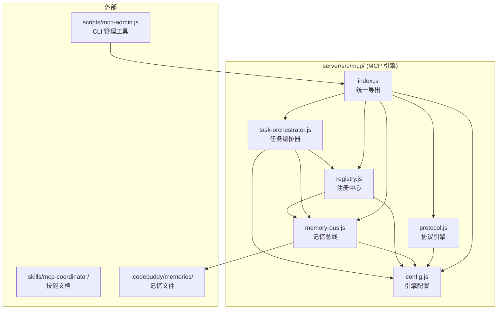

## 用户需求

开发一个统一的 MCP 规则引擎和记忆技能 Agent，作为 B Admin 项目的核心协调器，将已有的 26 个文档规范文件转化为实际可执行的运行时代码。

### 核心功能

**MCP 通信协议引擎**：基于 mcp-protocol.md 中定义的 12 种消息类型、4 条通信通道、10 种错误码和标准消息信封格式，使用 Zod 实现 Schema 验证，提供消息构建器工厂函数，实现递增间隔重试策略和通道降级逻辑。

**共享记忆管理总线**：基于 memory-structure.md 中定义的 4 级作用域目录结构（system/shared/agents/registrations）、TTL 策略表、访问控制矩阵和记忆合并策略，实现 CRUD API、JSON 文件原子写入、TTL 过期自动清理、上下文快照创建与恢复。

**Agent 注册与发现**：基于 plugin-contract.md 的 5 步接入流程和 agent-registry.md 中定义的 20+ Agent 清单、3 级信任级别、四维权限矩阵（文件系统/数据库/API/记忆），实现自注册、能力发现、权限验证和 Agent 生命周期状态管理。

**任务分解与编排**：基于 state-machine.md 中定义的 12 阶段依赖图、状态转换矩阵、Gate Check 机制，实现阶段依赖验证、任务分解调度、并发/顺序执行编排和完成条件检查。

**持久化存储策略**：基于 memory-structure.md 中定义的 JSON Schema 和 TTL 策略，实现原子文件写入（写临时文件→fsync→重命名）、TTL 批量清理、写入冲突检测和会话间数据一致性保证。


## 技术栈

- 运行时：Node.js + Express，ESM 模块系统（package.json `"type": "module"`）
- 验证库：zod v3.23（已安装，用于消息信封 Schema 验证）
- ID 生成：uuid v10（已安装，用于消息 ID 和任务 ID）
- 文件操作：Node.js 内置 fs/path/crypto 模块，不引入新依赖
- 测试：Jest 29 + @jest/globals，`node --experimental-vm-modules` 运行

## 实现架构

### 系统架构

MCP 引擎作为独立模块嵌入现有 Express 服务器，位于 `server/src/mcp/` 目录下。引擎不直接依赖 Express，只依赖 Node.js 内置模块和已有项目依赖（uuid、zod）。各模块通过单例模式暴露 API，由 `index.js` 统一导出。



### 模块职责

**config.js** — 集中定义引擎配置：workspace 根路径、记忆存储根路径、TTL 策略映射、原子写入配置（临时文件后缀 `.tmp`）、清理任务间隔（默认 300 秒）。

**protocol.js** — 实现消息协议层。包含三个子模块：Zod Schema 定义（header/body/signature 验证）、消息构建器（buildMessage、buildResponse、buildError 工厂函数）、错误码映射（MCP-001 到 MCP-010，每种错误码关联默认处理策略和重试参数）。

**memory-bus.js** — 实现记忆总线运行时。核心函数包括 scopePath（解析作用域到文件路径）、readMemory/writeMemory/deleteMemory/listMemory（4 级作用域 CRUD，含访问控制检查）、atomicWrite（临时文件写入→fsync→重命名）、cleanExpired（根据 TTL 表扫描并清理过期记忆）、createSnapshot/restoreSnapshot（上下文快照）。

**registry.js** — 实现 Agent 注册中心。核心函数包括 register（创建 registrations JSON 和 agents 状态文件）、discover（扫描 registrations 目录返回活跃 Agent 列表）、checkPermission（根据 agentId 和操作类型查询四维权限矩阵）、updateStatus（Agent 生命周期状态转换验证）、sendHeartbeat（更新心跳时间戳）。

**task-orchestrator.js** — 实现任务编排调度。核心函数包括 validatePhaseTransition（根据状态机转换矩阵验证）、checkDependencies（验证前置阶段 completed）、decomposeTask（将高层任务分解为子任务列表）、scheduleExecution（识别并行/顺序依赖，生成执行计划）、executeGateCheck（执行 Gate Check 条件验证）。

### 数据流

```
Agent 调用 → protocol.buildMessage() 构建消息
          → registry.checkPermission() 验证权限
          → orchestrator.decomposeTask() 分解任务
          → orchestrator.scheduleExecution() 生成执行计划
          → memory-bus.writeMemory() 写入任务记录
          → memory-bus.readMemory() 读取上下文
          → 执行完成 → memory-bus.writeMemory() 写入结果
          → registry.updateStatus() 更新 Agent 状态
```

### 关键设计决策

1. **不引入新依赖**：利用已有的 uuid 和 zod，文件操作完全基于 Node.js 内置模块，避免增加项目复杂度
2. **JSON 文件存储**：与现有规范文档中的记忆总线设计完全一致，不使用数据库，便于 Agent 直接读写
3. **原子写入保证**：通过临时文件→fsync→重命名的三段式写入，确保崩溃安全
4. **单例模块模式**：通过 ESM 模块级变量实现单例，无需 DI 容器，调用方直接 import
5. **纯函数优先**：所有核心逻辑以纯函数导出，状态（配置、活跃 Agent 列表）通过模块级变量管理

## 实现细节

### 性能考量

记忆总线写入采用 200ms 防抖批量写入（与项目 sql.js 的 200ms 防抖一致），避免高频写入造成磁盘 I/O 瓶颈。TTL 清理采用惰性清理 + 定时器组合策略：每次读取时检查当前记忆是否过期（惰性），同时每 300 秒触发一次批量扫描（定时器）。Agent 发现结果缓存在模块级 Map 中，心跳检测时失效刷新。

### 日志策略

延续项目现有的 console.log/console.error 模式。协议层记录消息路由日志（发送方/接收方/消息类型），记忆总线记录写入操作（作用域/键/TTL），注册中心记录状态变更（Agent ID/旧状态/新状态），编排器记录阶段转换。不记录消息体内容，避免日志膨胀。

### 错误处理

所有公开 API 通过 try-catch 包装，异常统一转换为 MCP 错误码格式。文件操作失败时重试 3 次（间隔 1s/3s/10s），3 次均失败则抛出 MCP-004（通道不可用）。Zod 验证失败抛出 MCP-001（消息格式无效）。权限不足抛出 MCP-003（权限不足）。

### 兼容性

引擎作为独立模块，不影响现有业务代码。通过 `index.js` 按需导入，不修改 server.js 启动流程（除非用户需要启动时自动初始化 MCP 引擎）。CLI 工具 `scripts/mcp-admin.js` 为独立脚本，通过 `node scripts/mcp-admin.js <command>` 运行。

## 目录结构

```
f:/项目02/
├── server/
│   ├── src/
│   │   └── mcp/                          # [NEW] MCP 引擎主目录
│   │       ├── config.js                 # [NEW] 引擎配置：路径、TTL 映射、清理间隔、原子写入参数
│   │       ├── protocol.js               # [NEW] 协议引擎：Zod Schema 定义、消息构建器、10 种错误码、重试/降级
│   │       ├── memory-bus.js             # [NEW] 记忆总线：4 级作用域 CRUD、原子写入、TTL 清理、快照恢复
│   │       ├── registry.js               # [NEW] 注册中心：Agent 自注册、能力发现、四维权限验证、生命周期
│   │       ├── task-orchestrator.js      # [NEW] 任务编排器：阶段状态机、依赖验证、任务分解、并发调度
│   │       └── index.js                  # [NEW] 统一导出入口，提供 getCoordinator() 获取协调器实例
│   └── tests/
│       └── mcp/                          # [NEW] MCP 引擎测试
│           ├── protocol.test.js          # [NEW] 协议层测试：Schema 验证、消息构建、错误码映射、重试逻辑
│           ├── memory.test.js            # [NEW] 记忆总线测试：CRUD 操作、原子写入、TTL 清理、快照恢复
│           ├── registry.test.js          # [NEW] 注册中心测试：注册、发现、权限检查、状态转换
│           └── orchestrator.test.js      # [NEW] 编排器测试：阶段验证、依赖检查、任务分解、Gate Check
├── scripts/
│   └── mcp-admin.js                      # [NEW] CLI 管理工具：agent list/register/status，memory clean/snapshot
├── .codebuddy/
│   └── skills/
│       └── mcp-coordinator/
│           └── references/
│               └── engine.md             # [NEW] 引擎架构文档：模块关系图、API 参考、使用指南
└── package.json                          # [MODIFY] 新增 "mcp:admin" 脚本
```

## 关键代码结构

### protocol.js 核心接口

```javascript
// 消息信封 Zod Schema
export const MessageEnvelopeSchema = z.object({
  header: z.object({
    protocol: z.literal('mcp/v1'),
    messageId: z.string().uuid(),
    correlationId: z.string().uuid().nullable(),
    timestamp: z.string().datetime(),
    sender: z.object({
      agentId: z.string().min(1),
      agentType: z.enum(['coordinator', 'domain', 'external']),
      skillId: z.string().nullable()
    }),
    recipient: z.object({
      agentId: z.string().min(1),
      agentType: z.string().nullable()
    }),
    priority: z.enum(['low', 'normal', 'high', 'critical']),
    ttl: z.string().nullable()
  }),
  body: z.object({
    type: z.enum([/* 12 types */]),
    payload: z.record(z.unknown()),
    contentType: z.literal('application/json')
  })
})

// 消息构建器
export function buildMessage(type, payload, sender, recipient, options)
export function buildResponse(correlationId, payload, sender, recipient)

// 错误码映射
export const MCP_ERRORS = { /* MCP-001 到 MCP-010 */ }
export function createMCPError(code, detail)
```

### memory-bus.js 核心接口

```javascript
// 作用域路径解析
export function scopePath(scope, agentId)

// CRUD API（含访问控制）
export async function readMemory(scope, key, readerAgentId)
export async function writeMemory(scope, key, data, writerAgentId, ttl)
export async function deleteMemory(scope, key, agentId)
export async function listMemory(scope, readerAgentId)

// 原子写入
async function atomicWrite(filePath, data)

// TTL 清理
export async function cleanExpired(scopes)
export function startTTLCleaner(intervalMs)

// 快照
export async function createSnapshot(agentId)
export async function restoreSnapshot(agentId, snapshotId)
```

### registry.js 核心接口

```javascript
// 注册
export async function register(agentId, registration)
export async function discover(filter)

// 权限
export function checkPermission(agentId, operation, target)
export const PERMISSION_MATRIX = { /* 四维矩阵 */ }

// 生命周期
export async function updateStatus(agentId, newStatus)
export async function sendHeartbeat(agentId)
export function getStatus(agentId)
```

### task-orchestrator.js 核心接口

```javascript
// 状态机
export function validateTransition(phase, from, to)
export function checkDependencies(phase, dependencyGraph)

// 任务编排
export async function decomposeTask(description)
export async function scheduleExecution(tasks)

// Gate Check
export async function executeGateCheck(phase, checklist)

// 阶段定义
export const PHASE_DEPENDENCIES = { /* 12 阶段依赖图 */ }
export const STATE_TRANSITIONS = { /* 转换矩阵 */ }
```


## 技能

- **b-admin-rules**：项目级领域技能，定义所有代码必须遵循的风格约定（无分号、单引号、2空格缩进、ESM、JSDoc注释）。在编写所有 MCP 引擎代码和测试时，必须加载此技能以确保代码风格一致性。

- **mcp-coordinator**：元层协调技能，包含 7 份参考规范文档（协议、记忆、注册、插件契约、状态机、版本同步、架构）。在实现每个模块时，必须参考对应的规范文档以确保代码与设计文档完全一致。

## 子 Agent

- **code-explorer**：用于在实现前快速搜索和验证现有代码模式，包括已有的 service 文件代码风格、测试文件结构、import 路径约定等，确保 MCP 引擎代码与项目惯例对齐。
