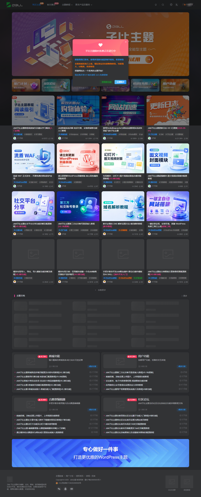
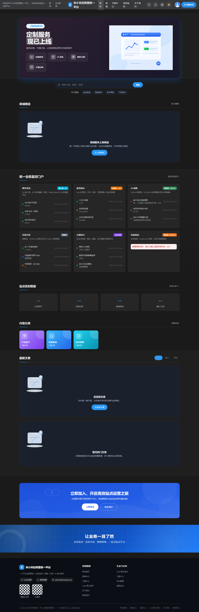
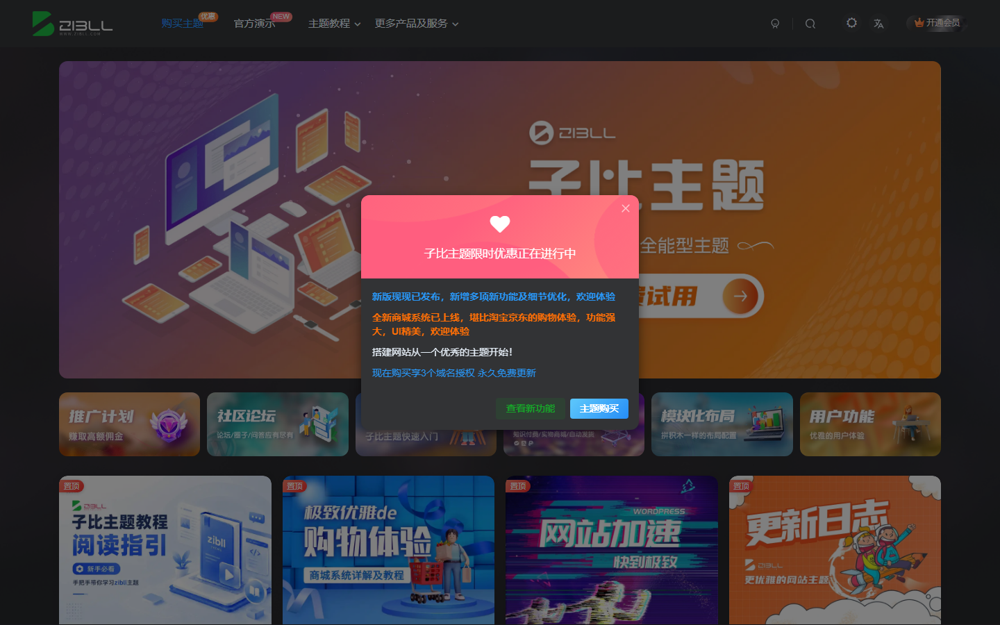
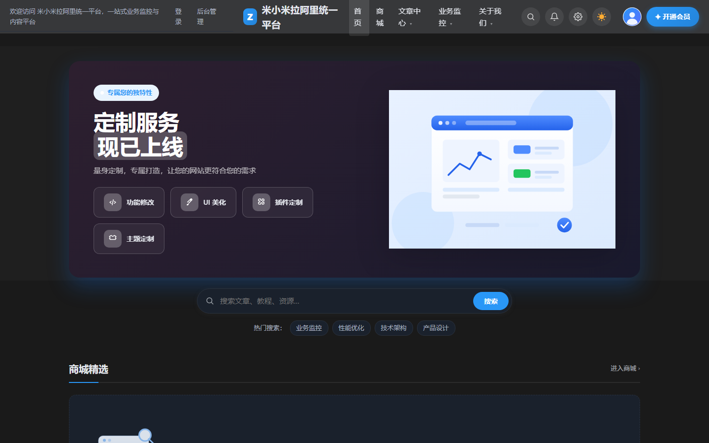
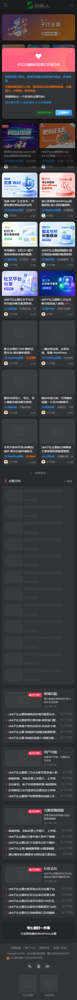
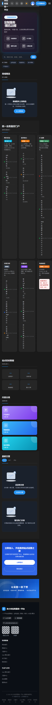

# 主题对比分析报告：zibstyle 主题 vs 参考站 zibll.com

- 报告日期：2026-09-07
- 对比对象：
  - 参考站：https://www.zibll.com/ （子比主题官网，深色模式）
  - 本地站：http://localhost/ （米小米拉阿里统一平台，zibstyle 主题，深色模式）
- 采集方式：Playwright 1440×900 视口自动截图 + 计算样式提取（`getComputedStyle`）+ CSS 变量抓取
- 数据文件：
  - 参考站设计数据：[design.json](../screenshots/zibll-ref/design.json)
  - 本地站设计数据：[design.json](../screenshots/local-site/design.json)
- 截图：
  - 参考站整页：
  - 本地站整页：
  - 首屏对比： ｜ 
  - 移动端对比： ｜ 

---

## 一、总体结论

本地主题整体骨架（固定顶栏 + 居中容器 + 卡片流 + 深色模式）与参考站一致，属于同一大类视觉体系，但在 **主色、容器宽度、字号层级、阴影语言、导航密度、深色底色调性** 六个方面存在明显偏差，导致"神似而形不似"。差异多源于主题独立开发时的默认值选择，以及菜单版本控制导致旧结构未被重建。

---

## 二、分维度差异明细

### 2.1 色彩方案

#### D1 主色调（P0）

| | 参考站 zibll | 本地站 |
|---|---|---|
| 主色 | `#f04494`（品红/粉色，品牌色） | `#2997f7`（蓝色） |
| 焦点阴影 | `rgba(253,83,161,.4)` | `rgba(41,151,247,.4)` |
| 强调色透明度层 | `.1 / .05 / .3 / .6` 四档 | 仅 `.1 / .05` 两档 |

- **差异特征**：整站强调色色相完全不同，参考站为暖粉，本地为冷蓝；参考站定义了 4 档透明度强调色用于 hover/selected 状态渐变，本地只有 2 档，导致交互状态层次较平。
- **原因分析**：主题开发时为避免与子比品牌色雷同而选择了蓝色；`functions.php` 中 `zibstyle_enqueue()` 注入的 `--primary` 默认值为 `#2997f7`，`customizer.php` 默认值同步，数据库 `theme_mods` 中已持久化。
- **改进建议**：将主色统一切换为 `#f04494`：① 修改 `functions.php`/`customizer.php` 默认值；② 更新数据库 `theme_mods_zibstyle` 的 `zibstyle_primary_color`；③ 在 `style.css` 补齐 `--primary-opacity3/.6` 两档透明度变量并在 hover 态使用。

#### D2 深色模式底色调性（P1）

| | 参考站 | 本地站 |
|---|---|---|
| body 背景 | `rgb(41,42,45)` ≈ `#292a2d`（中性灰黑） | `#0f141b`（偏冷的深蓝黑） |
| 卡片背景 | `rgb(50,51,53)` ≈ `#323335` | `#1a212c` |
| 头部背景 | `rgb(55,56,58)` ≈ `#37383a` | `rgb(55,56,58)`（一致） |

- **差异特征**：参考站深色模式是"中性灰阶"（29→50→55 灰度递进），本地是"蓝黑阶"，视觉上更冷、对比更硬。
- **原因分析**：本地 `--dark-bg/--dark-bg-soft/--dark-card` 为独立选定的蓝黑系，未对齐参考站的灰阶递进逻辑。
- **改进建议**：将 `--dark-bg: #292a2d`、`--dark-bg-soft: #2f3033`、`--dark-card: #323335`，保持与头部 `#37383a` 的灰阶连续性。

### 2.2 布局结构

#### D3 容器宽度（P0）

| | 参考站 | 本地站 |
|---|---|---|
| 实测容器 | `max-width: 1300px`，实际渲染 1300px | `max-width: 1200px`，实际渲染 1200px |

- **差异特征**：本地内容区比参考站窄 100px，宽屏下两侧留白更多，卡片列宽被压缩，信息密度偏低。
- **原因分析**：`style.css` 第 26/42 行 `--main-max-width` 与 `--maxw` 目前仍为 1200px（此前修改未落盘）。
- **改进建议**：将两处变量均改为 `1300px`，并全局检索硬编码的 `1200px` 一并替换。

#### D4 头部（Header）结构与效果（P2）

| | 参考站 | 本地站 |
|---|---|---|
| 定位/高度 | `fixed`，68.3px | `fixed`，68px（一致） |
| 背景 | 深色模式为实底 `#37383a`，无 `backdrop-filter` | 实底 + `backdrop-filter: blur(12px)` |
| 浅色模式背景 | `rgba(255,255,255,.8)` + blur（`--blur-bg` 变量） | 白色实底 |

- **差异特征**：本地深色模式下 `blur(12px)` 无实际作用（背景不透明），属于冗余计算；浅色模式下本地是实底白，参考站是 80% 白 + 磨砂，滚动时参考站透出内容边缘更有"悬浮感"。
- **原因分析**：本地一次性给 `.site-header` 加了磨砂效果（`style.css` 约 2175 行），未按深浅模式区分。
- **改进建议**：浅色模式 `.site-header { background: rgba(255,255,255,.8); backdrop-filter: blur(12px); }`；深色模式 `background: #37383a` 且移除 `backdrop-filter`。

#### D5 导航菜单密度（P0）

| | 参考站 | 本地站 |
|---|---|---|
| 顶栏主菜单 | 4 项：购买主题(优惠)/官方演示(NEW)/主题教程/更多产品及服务 | 实测顶栏 13 个链接：登录、后台管理、首页、商城、文章中心、产品设计、性能优化、技术架构、业务监控、SaaS 聚合演示、站点实时数据、关于我们 等 |
| 结构策略 | 顶级项极少 + 下拉子菜单 + 角标（优惠/NEW） | 分类全部平铺为顶级项 |

- **差异特征**：参考站"顶级 ≤5 + 下拉"，信息分层清晰；本地 13 项平铺，1440px 下勉强一行、1280px 下开始挤压/换行，且"登录""后台管理"这类账号入口与导航内容混排。
- **原因分析**：① `zibstyle_menu_version` 选项已为 `'3'`，`zibstyle_default_menu()` 幂等跳过，旧菜单结构不会被重建；② v3 构建逻辑把全部顶级分类挂到"文章中心"下拉，但站点实际分类（产品设计/性能优化/技术架构等）在后台仍独立存在并被其他逻辑平铺进导航；③ 账号入口未与主菜单分离。
- **改进建议**：
  1. 重构 `zibstyle_build_primary_menu()`：顶级只保留 6 项——首页 / 商城 / 文章中心（下拉含全部分类）/ 业务监控 / SaaS 聚合演示 / 关于我们；
  2. "登录/后台管理"移出主菜单，固定渲染在头部右侧工具区（登录按钮 + 深色切换）；
  3. 菜单版本号升至 `'4'`，触发存量站点自动重建；
  4. 为菜单项支持角标（如"优惠""NEW"），样式对齐参考站。

#### D6 页脚（P2）

| | 参考站 | 本地站 |
|---|---|---|
| 结构 | 无区块标题，纯三列小工具 + 底部版权 | 带"快速链接""生态与支持"标题的两列 + 版权 |

- **差异特征**：本地页脚多了标题层级，视觉上更"重"；参考站页脚更轻量、留白更多。
- **原因分析**：本地 `footer.php` 按通用站群模板加了两组带标题链接列。
- **改进建议**：保留信息但弱化标题（13px 灰字、去掉大标题样式），或改为无标题列表 + 更多留白；页脚背景浅色用 `#fff`、深色用 `#292a2d`，与参考站一致。

### 2.3 排版样式

#### D7 正文字号与行高（P1）

| | 参考站 | 本地站 |
|---|---|---|
| body 字号 | 14px | 15px |
| body 行高 | 20px（1.43） | 24px（1.6） |
| 字族 | "Helvetica Neue", Helvetica, Arial, sans-serif | -apple-system, "Segoe UI", "PingFang SC", … |

- **差异特征**：本地正文大一号、行高更松，同样篇幅占屏更多，整体观感"更疏朗"，参考站则更紧凑克制。
- **原因分析**：本地按移动端优先可读性选择了 15px/1.6；参考站以桌面信息密度优先。
- **改进建议**：`body { font-size: 14px; line-height: 1.6; }`（行高保留 1.6 照顾中文可读性，属可接受的微调）；正文内容区行高单独保持 1.7。字族本地保留系统栈（中文渲染优于纯 Helvetica 栈），**此项为可接受差异，不强制对齐**。

#### D8 标题层级（P1）

| | 参考站 | 本地站 |
|---|---|---|
| 首屏大标题 | 无 40px+ 巨标题（官网用图文替代） | h1 = 44px / 900 字重 |
| h2 | 14px / 500（官网语境） | 20px / 700 |
| h3 | — | 17px / 700 |

- **差异特征**：本地 Hero 的 44px/900 巨标题与参考站克制的标题语言冲突明显；参考站全站标题偏小、字重偏轻，靠层级间距而非字号制造层次。
- **原因分析**：本地 Hero 采用"大标题 SaaS 落地页"风格，与参考站"小标题 + 卡片"风格不同源。
- **改进建议**：Hero h1 降至 32–36px、字重 700；h2 保持 20px 但字重 600；标题颜色深色模式下用 `#f8fafc` 而非纯白，降低刺眼感。

### 2.4 组件与卡片

#### D9 卡片阴影语言（P1）

| | 参考站 | 本地站 |
|---|---|---|
| 圆角 | 12px（实测）/ `--main-radius: 8px`（小元素） | 12px（`--radius`）/ 8px（`--radius-sm`）一致 |
| 阴影 | `0 0 10px rgba(24,24,24,.1)`（无方向光晕） | `0 6px 22px rgba(31,39,51,.07)`（方向性投影） |
| 边框 | 无边框 | 1px `var(--line)` 边框 |

- **差异特征**：参考站卡片是"无描边 + 四周柔光"的悬浮感；本地是"描边 + 下方投影"的纸面感，两套阴影语言在并排对比时差异显著。
- **原因分析**：本地按 Material 风格设计卡片，参考站走 Web 2.0 柔光风格。
- **改进建议**：`--shadow: 0 0 10px rgba(24,24,24,.1)`（深色）/ `0 4px 14px rgba(0,0,0,.05)`（浅色）；去掉卡片 1px 边框，仅保留阴影分层；hover 用 `0 0 18px` + `translateY(-2px)`。

### 2.5 交互效果

#### D10 交互状态体系（P2）

| | 参考站 | 本地站 |
|---|---|---|
| 统一缓动 | 有（主题内置） | 有（`--ease: cubic-bezier(.4,0,.2,1)`，已对齐） |
| 卡片 hover | 上浮 + 阴影加深 | 已有部分（需统一到 D9 新阴影） |
| 轮播触摸滑动 | 有 | 已实现（main.js touchstart/touchend） |
| 深色切换 | 有 | 有（已对齐） |
| 回到顶部 | 官网未启用 | 未启用（一致） |

- **差异特征**：本地交互基础能力已对齐，剩余差异是 hover 态未使用"柔光加深"语言，且缺少参考站式的菜单下拉展开动画（fade + 8px 位移，150ms）。
- **改进建议**：① 导航下拉加 `opacity/translateY` 过渡 150ms `--ease`；② 所有卡片 hover 统一 `translateY(-2px)` + 柔光阴影加深；③ 按钮 hover 用 `--primary-opacity3` 过渡。

### 2.6 响应式设计

#### D11 移动端表现（P2）

| | 参考站 | 本地站 |
|---|---|---|
| 头部高度 | 约 50px（压缩） | 68px（与桌面相同） |
| 导航 | 汉堡菜单抽屉 | 汉堡菜单（menu-toggle，已具备） |
| 网格 | 单列流 | 单列（实测 grid 350px） |

- **差异特征**：本地移动端头部占 68px，在 844px 高的屏幕上占 8% 屏高，参考站约 6%；本地首屏 Hero 44px 标题在窄屏下换行更碎。
- **原因分析**：`--header-h` 未按断点收缩。
- **改进建议**：`@media (max-width: 768px)` 下 `--header-h: 52px`，Hero h1 降至 26px，容器 padding 16px。

### 2.7 功能模块组织

#### D12 模块差异汇总（P2）

| 模块 | 参考站 | 本地站 | 建议 |
|---|---|---|---|
| 账号入口 | 头部右侧独立按钮区 | 混入导航菜单 | 移出菜单，放头部右侧（见 D5） |
| 菜单角标 | 优惠 / NEW 标签 | 无 | 增加 `.menu-badge` 样式支持 |
| 首屏 | 品牌大图 + 小字标语 | 大标题 + 副文案 + 双按钮 | 降字号即可，结构保留 |
| 数据统计 | 无（官网） | 站点实时数据板块 | 保留，属本地增值模块 |
| 深色模式 | 有 | 有（已对齐） | 仅调底色（见 D2） |

---

## 三、差异优先级汇总表

| 编号 | 差异 | 维度 | 优先级 | 涉及文件 |
|---|---|---|---|---|
| D1 | 主色 蓝→粉 `#f04494` + 4 档透明度 | 色彩 | **P0** | functions.php, customizer.php, style.css, 数据库 theme_mods |
| D3 | 容器 1200px→1300px | 布局 | **P0** | style.css（26/42 行及硬编码处） |
| D5 | 导航收敛为 6 顶级项 + 账号入口分离 + 角标 | 布局/功能 | **P0** | functions.php（菜单构建 v4）, header.php, style.css |
| D2 | 深色底色调性灰阶化 | 色彩 | P1 | style.css 深色变量 |
| D7 | 正文 14px（行高 1.6 保留） | 排版 | P1 | style.css |
| D8 | 标题层级降档（h1 32–36px/700） | 排版 | P1 | style.css, home.css |
| D9 | 卡片阴影改柔光 + 去边框 | 组件 | P1 | style.css |
| D4 | 头部磨砂按深浅模式区分 | 布局 | P2 | style.css |
| D6 | 页脚轻量化 | 功能模块 | P2 | footer.php, style.css |
| D10 | hover/下拉动效统一 | 交互 | P2 | style.css, main.js |
| D11 | 移动端头部 52px + 断点微调 | 响应式 | P2 | style.css |
| D7b | 字族 | 排版 | 不处理 | 可接受差异（中文渲染考量） |

---

## 四、改进任务计划

| # | 任务 | 目标 | 实施步骤 | 负责 | 时间节点 |
|---|---|---|---|---|---|
| T1 | 主色切换 D1 | 全站强调色与参考站一致 | ① 改 functions.php / customizer.php 默认值为 `#f04494`；② 更新 SQLite `theme_mods_zibstyle` 的 `zibstyle_primary_color`；③ style.css 补 `--primary-opacity3/.6` 并应用于 hover；④ cachebust 验证深浅模式 | 主题开发（AI Agent） | 2026-09-08 |
| T2 | 容器宽度 D3 | 内容区实测 1300px | ① style.css `--main-max-width`/`--maxw` 改 1300px；② 全局检索硬编码 1200px 替换；③ Playwright 复测 `container.max-width` | 主题开发（AI Agent） | 2026-09-08 |
| T3 | 导航重构 D5 | 顶级 ≤6 项、1280px 不换行 | ① 重构 `zibstyle_build_primary_menu()`（6 顶级项 + 分类下拉）；② 账号入口移出菜单到 header.php 右侧工具区；③ 菜单版本升 `'4'` 触发重建；④ 新增 `.menu-badge` 样式 | 主题开发（AI Agent） | 2026-09-09 |
| T4 | 深色基调 + 卡片语言 D2/D9 | 灰阶底 + 柔光卡片 | ① `--dark-bg/#292a2d`、`--dark-card/#323335`；② `--shadow` 改柔光、去卡片边框；③ hover 上浮 + 阴影加深 | 主题开发（AI Agent） | 2026-09-10 |
| T5 | 排版对齐 D7/D8 | 14px 正文 + 克制标题 | ① body 14px；② Hero h1 32–36px/700；③ h2 字重 600；④ 深色标题色 `#f8fafc` | 主题开发（AI Agent） | 2026-09-11 |
| T6 | 头部/页脚/动效 D4/D6/D10 | 效果与语言对齐 | ① 头部磨砂按模式区分；② 页脚标题弱化；③ 下拉 150ms 淡入 + hover 态用 opacity3 | 主题开发（AI Agent） | 2026-09-12 |
| T7 | 响应式微调 D11 | 移动端头部 52px | ① 断点内 `--header-h: 52px`；② Hero h1 26px；③ 390px 视口回归测试 | 主题开发（AI Agent） | 2026-09-13 |
| T8 | 终验 | 与参考站视觉一致性达标 | ① Playwright 重新采集双站 design.json 与截图；② 逐项复核 D1–D11；③ 更新本报告验收结论 | 主题开发（AI Agent） | 2026-09-14 |

验收标准：
1. design.json 复测：容器 1300px、主色 `#f04494`、顶部菜单 ≤6 项；
2. 1440 / 1280 / 390px 三档视口截图与参考站并排无明显风格断层；
3. 深色模式下灰阶连续性（bg → card → header）成立，无蓝黑残留。
