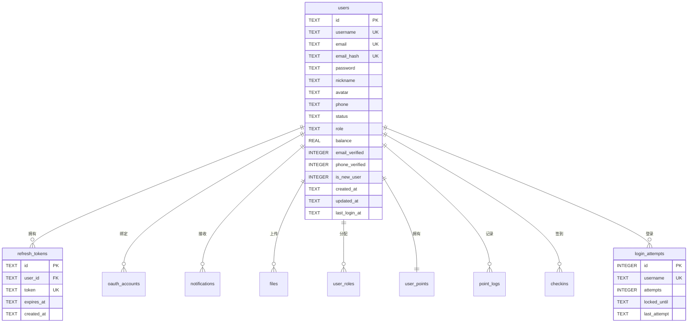
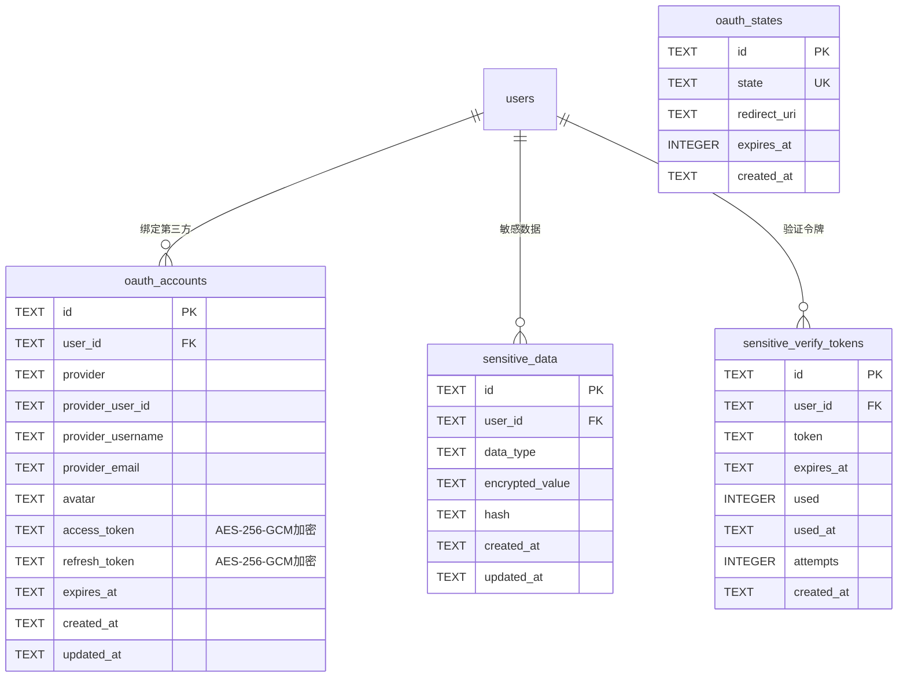
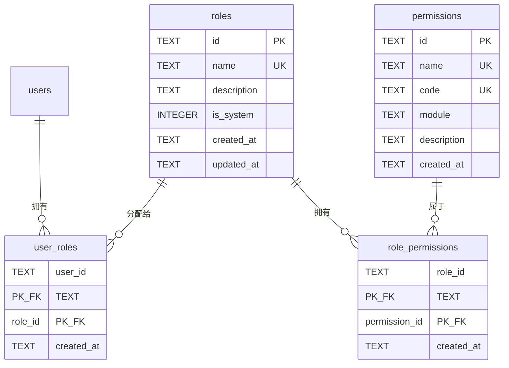
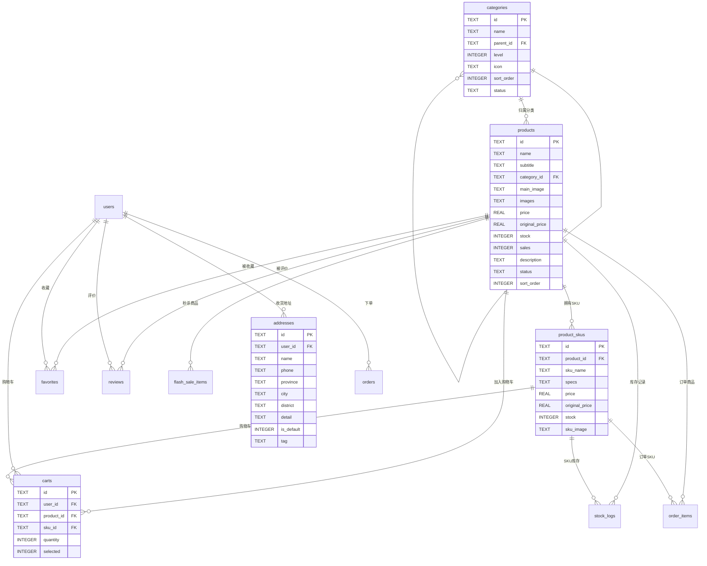
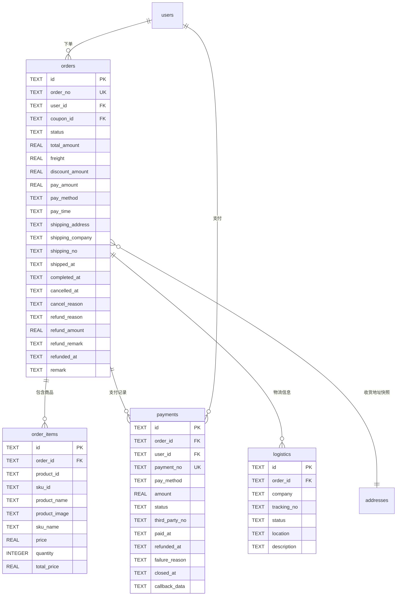
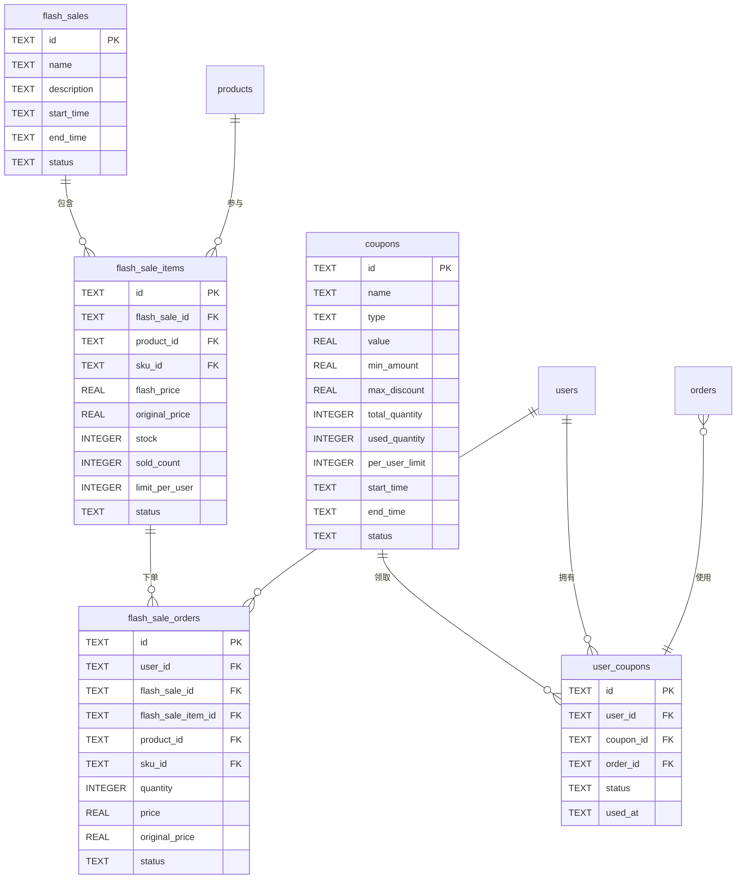

# 数据库设计文档

**文档版本**：v2.0.0
**最后更新**：2026-07-12
**数据库类型**：SQLite 3 / PostgreSQL 12+（双数据库支持）
**存储引擎**：SQLite WAL (Write-Ahead Logging) / PostgreSQL 默认存储引擎

---

## 目录

1. [数据库概述](#1-数据库概述)
2. [数据库抽象层设计](#2-数据库抽象层设计)
3. [双写一致性服务](#3-双写一致性服务)
4. [ER 图描述](#4-er-图描述)
5. [用户系统表](#5-用户系统表)
6. [OAuth 认证表](#6-oauth-认证表)
7. [RBAC 权限表](#7-rbac-权限表)
8. [商城模块表](#8-商城模块表)
9. [订单与支付表](#9-订单与支付表)
10. [营销活动表](#10-营销活动表)
11. [会员积分表](#11-会员积分表)
12. [聊天消息表](#12-聊天消息表)
13. [系统管理表](#13-系统管理表)
14. [索引清单](#14-索引清单)
15. [枚举值定义](#15-枚举值定义)
16. [数据迁移与初始化](#16-数据迁移与初始化)
17. [SQLite 与 PostgreSQL 差异对照](#17-sqlite-与-postgresql-差异对照)

---

## 1. 数据库概述

### 1.1 设计规范

| 规范项 | SQLite | PostgreSQL | 说明 |
|--------|--------|------------|------|
| 主键类型 | TEXT (UUID v4) | TEXT (UUID v4) | 统一使用 UUID，避免自增 ID 跨库冲突 |
| 时间字段 | TEXT (ISO 8601) | TIMESTAMP | SQLite 使用文本存储，PG 使用原生时间类型 |
| 数值字段 | REAL / INTEGER | NUMERIC / BIGINT | 金额字段 PG 使用 NUMERIC 保证精度 |
| 布尔值 | INTEGER (0/1) | INTEGER (0/1) | 统一使用 0/1 表示布尔值 |
| JSON 字段 | TEXT (JSON 字符串) | TEXT (JSON 字符串) | 以文本形式存储 JSON 数据 |
| 外键约束 | 启用 (PRAGMA foreign_keys=ON) | 启用 (FOREIGN KEY) | 均启用外键约束 |
| 命名风格 | snake_case | snake_case | 统一小写+下划线命名 |

### 1.2 表分类总览

| 分类 | 表数量 | 说明 |
|------|--------|------|
| 用户系统 | 3 | users、refresh_tokens、login_attempts |
| OAuth 认证 | 4 | oauth_accounts、oauth_states、sensitive_data、sensitive_verify_tokens |
| RBAC 权限 | 4 | roles、permissions、role_permissions、user_roles |
| 商城模块 | 7 | categories、products、product_skus、carts、addresses、favorites、stock_logs |
| 订单与支付 | 5 | orders、order_items、payments、logistics、reconciliation_records |
| 营销活动 | 4 | coupons、user_coupons、flash_sales、flash_sale_items、flash_sale_orders |
| 会员积分 | 4 | member_levels、user_points、point_logs、checkins |
| 聊天消息 | 5 | conversations、messages、comments、conversation_reads、inbox_messages |
| 系统管理 | 7 | notifications、files、sync_records、error_logs、search_history、shipping_templates、audit_logs |
| 验证码 | 1 | verify_codes |
| **合计** | **44** | 完整覆盖电商商城全业务场景 |

### 1.3 SQLite 性能优化配置

```sql
PRAGMA journal_mode = WAL;        -- 写前日志模式，提升并发性能
PRAGMA foreign_keys = ON;         -- 启用外键约束
PRAGMA synchronous = NORMAL;      -- 同步级别，平衡安全与性能
PRAGMA cache_size = -64000;       -- 缓存大小 64MB
PRAGMA temp_store = MEMORY;       -- 临时表存内存
PRAGMA mmap_size = 268435456;     -- 内存映射 256MB
PRAGMA encoding = "UTF-8";        -- UTF-8 编码
```

### 1.4 PostgreSQL 连接池配置

```javascript
{
  host: 'localhost',
  port: 5432,
  database: 'gexm',
  user: 'postgres',
  password: '******',
  max: 20,                        -- 最大连接数
  idleTimeoutMillis: 30000,       -- 空闲超时 30 秒
  connectionTimeoutMillis: 2000   -- 连接超时 2 秒
}
```

---

## 2. 数据库抽象层设计

### 2.1 ISyncDbClient 接口

数据库抽象层位于 [packages/server/src/models/index.ts](file:///f:/gexm/packages/server/src/models/index.ts)，定义统一的同步数据库客户端接口，支持 SQLite 和 PostgreSQL 双数据库实现。

```typescript
interface SyncPreparedStatement {
  run: (...params: unknown[]) => { changes: number; lastInsertRowid: number }
  get: (...params: unknown[]) => any
  all: (...params: unknown[]) => any[]
}

export interface ISyncDbClient {
  prepare: (sql: string) => SyncPreparedStatement    // 预处理语句
  exec: (sql: string) => void                         // 执行 SQL（无参数）
  transaction: <T>(fn: () => T) => () => T            // 事务支持
  pragma: (sql: string) => unknown[]                  // PRAGMA 命令（仅 SQLite）
  close: () => void                                   // 关闭连接
}
```

### 2.2 SQLiteSyncClient 实现

基于 `better-sqlite3` 库实现的同步数据库客户端，提供高性能的本地数据库访问。

**核心特性**：
- 同步 API，避免异步回调地狱
- WAL 模式提升并发读写性能
- 自动创建数据库目录
- 启用外键约束和性能优化 PRAGMA

### 2.3 PostgreSQL 客户端实现

基于 `pg.Pool` 实现的 PostgreSQL 客户端，通过同步封装适配 ISyncDbClient 接口。

**核心特性**：
- 连接池管理（max: 20 连接）
- 事务支持（BEGIN/COMMIT/ROLLBACK）
- 自动回滚异常事务
- PRAGMA 命令兼容处理（输出警告日志）

### 2.4 数据库初始化流程

```
initDatabase()
  ├── 读取 config.database.type
  ├── type === 'postgres' ?
  │   ├── 尝试初始化 PostgreSQL
  │   └── 失败则降级为 SQLite
  └── type === 'sqlite' ?
      └── 初始化 SQLiteSyncClient
  ├── createTables()           -- 创建所有表结构
  ├── migrateDatabase()        -- 执行数据库迁移
  └── initDefaultData()        -- 初始化默认数据
```

### 2.5 数据库切换配置

通过环境变量 `DB_TYPE` 切换数据库类型：

```env
# SQLite 配置（默认）
DB_TYPE=sqlite
DB_PATH=/opt/gexm/data/gexm.db

# PostgreSQL 配置
DB_TYPE=postgres
DB_HOST=localhost
DB_PORT=5432
DB_NAME=gexm
DB_USER=postgres
DB_PASSWORD=your_password
```

---

## 3. 双写一致性服务

双写一致性服务位于 [packages/server/src/services/dualWriteService.ts](file:///f:/gexm/packages/server/src/services/dualWriteService.ts)，提供 SQLite 与 PostgreSQL 之间的数据双写和一致性校验功能。

### 3.1 核心功能

| 功能 | 方法 | 说明 |
|------|------|------|
| 启用双写 | `enableDualWrite()` | 开启 SQLite→PostgreSQL 双写模式 |
| 禁用双写 | `disableDualWrite()` | 关闭双写模式 |
| 双写状态 | `isDualWriteActive()` | 查询双写是否激活 |
| 双写写入 | `dualWrite(table, data)` | 同步写入两个数据库 |
| 双写执行 | `dualExec(sql, params)` | 同步执行 SQL 语句 |
| 一致性检查 | `verifyDualWriteConsistency(table)` | 校验单表数据一致性 |
| 全表检查 | `verifyAllTablesConsistency()` | 校验所有表一致性 |
| 表行对比 | `compareTableRows(table)` | 对比表行数和内容 |
| 修复表 | `repairTable(table)` | 修复不一致的表数据 |
| 插入缺失行 | `insertMissingRow(table, row)` | 插入缺失的数据行 |
| 更新不匹配行 | `updateMismatchedRow(table, row)` | 更新不一致的数据行 |
| 自动修复 | `autoRepairInconsistencies()` | 自动修复所有不一致 |
| 状态查询 | `getDualWriteStatus()` | 获取双写服务状态 |

### 3.2 一致性检查机制

```
startConsistencyCheck(interval)
  ├── 定时任务（默认 5 分钟）
  ├── 遍历所有表
  │   ├── compareTableRows(table)
  │   │   ├── 对比行数
  │   │   └── 对比行内容
  │   └── 记录差异
  ├── 自动修复不一致
  │   ├── insertMissingRow()
  │   └── updateMismatchedRow()
  └── 生成一致性报告
```

### 3.3 双写流程

```
写入请求
  ├── 写入 SQLite（主库）
  ├── dualWrite 激活?
  │   ├── 是 → 异步写入 PostgreSQL（从库）
  │   │   ├── 成功 → 完成
  │   │   └── 失败 → 记录日志，等待修复
  │   └── 否 → 仅写入 SQLite
  └── 返回结果
```

---

## 4. ER 图描述

### 4.1 用户系统 ER 图



### 4.2 OAuth 认证 ER 图



### 4.3 RBAC 权限 ER 图



### 4.4 商城模块 ER 图



### 4.5 订单支付 ER 图



### 4.6 营销活动 ER 图



### 4.7 会员积分 ER 图

```mermaid
erDiagram
    users ||--|| user_points : "拥有积分"
    member_levels ||--o{ user_points : "等级"
    users ||--o{ point_logs : "积分记录"
    users ||--o{ checkins : "签到记录"

    member_levels {
        TEXT id PK
        TEXT name
        INTEGER min_points
        REAL discount_rate
        TEXT benefits
        INTEGER sort_order
    }

    user_points {
        TEXT id PK
        TEXT user_id FK_UK
        INTEGER balance
        TEXT level_id FK
        INTEGER total_earned
        INTEGER total_spent
    }

    point_logs {
        TEXT id PK
        TEXT user_id FK
        TEXT type
        INTEGER amount
        INTEGER balance
        TEXT reason
        TEXT order_id
        TEXT reference_type
        TEXT reference_id
    }

    checkins {
        TEXT id PK
        TEXT user_id FK
        TEXT checkin_date
        INTEGER streak_days
        INTEGER points_earned
    }
```

---

## 5. 用户系统表

### 5.1 users（用户表）

用户核心信息表，存储所有注册用户的账号资料。

| 字段名 | SQLite 类型 | PostgreSQL 类型 | 允许空 | 默认值 | 说明 |
|--------|-------------|-----------------|--------|--------|------|
| id | TEXT | TEXT | 否 | - | 主键，UUID v4 |
| username | TEXT | TEXT | 否 | - | 用户名，唯一索引 |
| email | TEXT | TEXT | 否 | - | 邮箱，唯一索引 |
| email_hash | TEXT | TEXT | 是 | NULL | 邮箱哈希值，唯一索引（GDPR合规） |
| password | TEXT | TEXT | 是 | NULL | 密码（bcrypt 加密） |
| nickname | TEXT | TEXT | 是 | NULL | 昵称 |
| avatar | TEXT | TEXT | 是 | NULL | 头像 URL |
| phone | TEXT | TEXT | 是 | NULL | 手机号 |
| status | TEXT | TEXT | 是 | 'active' | 账号状态 |
| role | TEXT | TEXT | 是 | 'user' | 用户角色 |
| balance | REAL | NUMERIC | 是 | 0 | 账户余额 |
| email_verified | - | INTEGER | 是 | 0 | 邮箱是否验证（PG 新增） |
| phone_verified | - | INTEGER | 是 | 0 | 手机是否验证（PG 新增） |
| is_new_user | - | INTEGER | 是 | 1 | 是否新用户（PG 新增） |
| created_at | TEXT | TIMESTAMP | 否 | CURRENT_TIMESTAMP | 创建时间 |
| updated_at | TEXT | TIMESTAMP | 否 | CURRENT_TIMESTAMP | 更新时间 |
| last_login_at | TEXT | TIMESTAMP | 是 | NULL | 最后登录时间 |

**索引**：
- `idx_users_username` (username)
- `idx_users_email` (email)
- `idx_users_email_hash` (email_hash) UNIQUE
- `idx_users_created_at` (created_at)

### 5.2 refresh_tokens（刷新令牌表）

存储 JWT 刷新令牌，支持令牌吊销机制。

| 字段名 | SQLite 类型 | PostgreSQL 类型 | 允许空 | 默认值 | 说明 |
|--------|-------------|-----------------|--------|--------|------|
| id | TEXT | TEXT | 否 | - | 主键，UUID v4 |
| user_id | TEXT | TEXT | 否 | - | 关联用户 ID，外键 → users.id (CASCADE) |
| token | TEXT | TEXT | 否 | - | 刷新令牌值，唯一 |
| expires_at | TEXT | TIMESTAMP | 否 | - | 过期时间 |
| created_at | TEXT | TIMESTAMP | 否 | CURRENT_TIMESTAMP | 创建时间 |

### 5.3 login_attempts（登录尝试表）

记录用户登录尝试次数，用于防暴力破解。

| 字段名 | SQLite 类型 | PostgreSQL 类型 | 允许空 | 默认值 | 说明 |
|--------|-------------|-----------------|--------|--------|------|
| id | INTEGER | SERIAL | 否 | AUTOINCREMENT/SERIAL | 主键 |
| username | TEXT | TEXT | 否 | - | 用户名，唯一 |
| attempts | INTEGER | INTEGER | 是 | 0 | 尝试次数 |
| locked_until | TEXT | TIMESTAMP | 是 | NULL | 锁定截止时间 |
| last_attempt | TEXT | TIMESTAMP | 否 | - | 最后尝试时间 |

**索引**：
- `idx_login_attempts_username` (username)

---

## 6. OAuth 认证表

### 6.1 oauth_accounts（第三方账号绑定表）

存储用户绑定的第三方平台账号信息，敏感字段（access_token、refresh_token）使用 AES-256-GCM 加密存储。

| 字段名 | SQLite 类型 | PostgreSQL 类型 | 允许空 | 默认值 | 说明 |
|--------|-------------|-----------------|--------|--------|------|
| id | TEXT | TEXT | 否 | - | 主键 |
| user_id | TEXT | TEXT | 否 | - | 关联用户 ID (CASCADE) |
| provider | TEXT | TEXT | 否 | - | OAuth 提供商（wechat/qq/weibo/alipay/google/facebook/twitter） |
| provider_user_id | TEXT | TEXT | 否 | - | 第三方平台用户 ID |
| provider_username | TEXT | TEXT | 是 | NULL | 第三方用户名 |
| provider_email | TEXT | TEXT | 是 | NULL | 第三方邮箱 |
| avatar | TEXT | TEXT | 是 | NULL | 第三方头像 URL |
| access_token | TEXT | TEXT | 是 | NULL | 访问令牌（AES-256-GCM 加密） |
| refresh_token | TEXT | TEXT | 是 | NULL | 刷新令牌（AES-256-GCM 加密） |
| expires_at | TEXT | TIMESTAMP | 是 | NULL | 令牌过期时间 |
| created_at | TEXT | TIMESTAMP | 否 | CURRENT_TIMESTAMP | 创建时间 |
| updated_at | TEXT | TIMESTAMP | 否 | CURRENT_TIMESTAMP | 更新时间 |

**唯一约束**：`UNIQUE(provider, provider_user_id)` — 同一平台同一用户只能绑定一次

**索引**：
- `idx_oauth_provider` (provider)
- `idx_oauth_user_id` (user_id)
- `idx_oauth_provider_user` (provider, provider_user_id)

### 6.2 oauth_states（OAuth 状态表）

存储 OAuth 授权流程的 state 参数，防止 CSRF 攻击。

| 字段名 | SQLite 类型 | PostgreSQL 类型 | 允许空 | 默认值 | 说明 |
|--------|-------------|-----------------|--------|--------|------|
| id | TEXT | TEXT | 否 | - | 主键 |
| state | TEXT | TEXT | 否 | - | state 值，唯一 |
| redirect_uri | TEXT | TEXT | 是 | NULL | 回调地址 |
| expires_at | INTEGER | BIGINT | 否 | - | 过期时间戳 |
| created_at | TEXT | TIMESTAMP | 否 | CURRENT_TIMESTAMP | 创建时间 |

**索引**：
- `idx_oauth_states_state` (state)
- `idx_oauth_states_expires` (expires_at)

### 6.3 sensitive_data（敏感数据表）

存储用户的敏感数据（如身份证号、银行卡号等），加密存储。

| 字段名 | SQLite 类型 | PostgreSQL 类型 | 允许空 | 默认值 | 说明 |
|--------|-------------|-----------------|--------|--------|------|
| id | TEXT | TEXT | 否 | - | 主键 |
| user_id | TEXT | TEXT | 否 | - | 关联用户 ID (CASCADE) |
| data_type | TEXT | TEXT | 否 | - | 数据类型（id_card/bank_card 等） |
| encrypted_value | TEXT | TEXT | 否 | - | 加密后的值 |
| hash | TEXT | TEXT | 否 | - | 哈希值（用于查询比对） |
| created_at | TEXT | TIMESTAMP | 否 | CURRENT_TIMESTAMP | 创建时间 |
| updated_at | TEXT | TIMESTAMP | 否 | CURRENT_TIMESTAMP | 更新时间 |

**唯一约束**：`UNIQUE(user_id, data_type)` — 每个用户每种类型只能有一条记录

### 6.4 sensitive_verify_tokens（敏感操作验证令牌表）

敏感操作（如修改密码、提现）的二次验证令牌。

| 字段名 | SQLite 类型 | PostgreSQL 类型 | 允许空 | 默认值 | 说明 |
|--------|-------------|-----------------|--------|--------|------|
| id | TEXT | TEXT | 否 | - | 主键 |
| user_id | TEXT | TEXT | 否 | - | 关联用户 ID (CASCADE) |
| token | TEXT | TEXT | 否 | - | 验证令牌 |
| expires_at | TEXT | TIMESTAMP | 否 | - | 过期时间 |
| used | INTEGER | INTEGER | 是 | 0 | 是否已使用 |
| used_at | TEXT | TIMESTAMP | 是 | NULL | 使用时间 |
| attempts | INTEGER | INTEGER | 是 | 0 | 尝试次数 |
| created_at | TEXT | TIMESTAMP | 否 | CURRENT_TIMESTAMP | 创建时间 |

---

## 7. RBAC 权限表

### 7.1 roles（角色表）

| 字段名 | SQLite 类型 | PostgreSQL 类型 | 允许空 | 默认值 | 说明 |
|--------|-------------|-----------------|--------|--------|------|
| id | TEXT | TEXT | 否 | - | 主键 |
| name | TEXT | TEXT | 否 | - | 角色名称，唯一 |
| description | TEXT | TEXT | 是 | NULL | 角色描述 |
| is_system | INTEGER | INTEGER | 是 | 0 | 是否系统角色（系统角色不可删除/修改） |
| created_at | TEXT | TIMESTAMP | 否 | CURRENT_TIMESTAMP | 创建时间 |
| updated_at | TEXT | TIMESTAMP | 否 | CURRENT_TIMESTAMP | 更新时间 |

**内置角色**：
- `super_admin`（超级管理员）：系统最高权限
- `product_admin`（商品管理员）：商品管理权限
- `order_admin`（订单管理员）：订单管理权限
- `finance_admin`（财务管理员）：财务管理权限

### 7.2 permissions（权限表）

| 字段名 | SQLite 类型 | PostgreSQL 类型 | 允许空 | 默认值 | 说明 |
|--------|-------------|-----------------|--------|--------|------|
| id | TEXT | TEXT | 否 | - | 主键 |
| name | TEXT | TEXT | 否 | - | 权限名称，唯一 |
| code | TEXT | TEXT | 否 | - | 权限代码，唯一（如 product:create） |
| module | TEXT | TEXT | 否 | - | 所属模块（product/order/user 等） |
| description | TEXT | TEXT | 是 | NULL | 权限描述 |
| created_at | TEXT | TIMESTAMP | 否 | CURRENT_TIMESTAMP | 创建时间 |

### 7.3 role_permissions（角色权限关联表）

| 字段名 | SQLite 类型 | PostgreSQL 类型 | 允许空 | 默认值 | 说明 |
|--------|-------------|-----------------|--------|--------|------|
| role_id | TEXT | TEXT | 否 | - | 角色ID (CASCADE)，联合主键 |
| permission_id | TEXT | TEXT | 否 | - | 权限ID (CASCADE)，联合主键 |
| created_at | TEXT | TIMESTAMP | 否 | CURRENT_TIMESTAMP | 创建时间 |

**主键**：`PRIMARY KEY (role_id, permission_id)`

### 7.4 user_roles（用户角色关联表）

| 字段名 | SQLite 类型 | PostgreSQL 类型 | 允许空 | 默认值 | 说明 |
|--------|-------------|-----------------|--------|--------|------|
| user_id | TEXT | TEXT | 否 | - | 用户ID (CASCADE)，联合主键 |
| role_id | TEXT | TEXT | 否 | - | 角色ID (CASCADE)，联合主键 |
| created_at | TEXT | TIMESTAMP | 否 | CURRENT_TIMESTAMP | 创建时间 |

**主键**：`PRIMARY KEY (user_id, role_id)`

---

## 8. 商城模块表

### 8.1 categories（商品分类表）

支持多级分类树形结构。

| 字段名 | SQLite 类型 | PostgreSQL 类型 | 允许空 | 默认值 | 说明 |
|--------|-------------|-----------------|--------|--------|------|
| id | TEXT | TEXT | 否 | - | 主键 |
| name | TEXT | TEXT | 否 | - | 分类名称 |
| parent_id | TEXT | TEXT | 是 | NULL | 父分类 ID (SET NULL) |
| level | INTEGER | INTEGER | 是 | 1 | 分类层级 |
| icon | TEXT | TEXT | 是 | NULL | 分类图标 |
| sort_order | INTEGER | INTEGER | 是 | 0 | 排序值 |
| status | TEXT | TEXT | 是 | 'active' | 状态 |
| created_at | TEXT | TIMESTAMP | 否 | CURRENT_TIMESTAMP | 创建时间 |
| updated_at | TEXT | TIMESTAMP | 否 | CURRENT_TIMESTAMP | 更新时间 |

### 8.2 products（商品表）

| 字段名 | SQLite 类型 | PostgreSQL 类型 | 允许空 | 默认值 | 说明 |
|--------|-------------|-----------------|--------|--------|------|
| id | TEXT | TEXT | 否 | - | 主键 |
| name | TEXT | TEXT | 否 | - | 商品名称 |
| subtitle | TEXT | TEXT | 是 | NULL | 副标题 |
| category_id | TEXT | TEXT | 是 | NULL | 分类 ID (SET NULL) |
| main_image | TEXT | TEXT | 是 | NULL | 主图 URL |
| images | TEXT | TEXT | 是 | NULL | 商品图片（JSON 数组） |
| price | REAL | NUMERIC | 否 | 0 | 销售价 |
| original_price | REAL | NUMERIC | 是 | NULL | 原价 |
| stock | INTEGER | INTEGER | 是 | 0 | 库存 |
| sales | INTEGER | INTEGER | 是 | 0 | 销量 |
| description | TEXT | TEXT | 是 | NULL | 详情描述 |
| status | TEXT | TEXT | 是 | 'on_sale' | 商品状态 |
| sort_order | INTEGER | INTEGER | 是 | 0 | 排序值 |
| created_at | TEXT | TIMESTAMP | 否 | CURRENT_TIMESTAMP | 创建时间 |
| updated_at | TEXT | TIMESTAMP | 否 | CURRENT_TIMESTAMP | 更新时间 |

### 8.3 product_skus（商品 SKU 表）

| 字段名 | SQLite 类型 | PostgreSQL 类型 | 允许空 | 默认值 | 说明 |
|--------|-------------|-----------------|--------|--------|------|
| id | TEXT | TEXT | 否 | - | 主键 |
| product_id | TEXT | TEXT | 否 | - | 商品 ID (CASCADE) |
| sku_name | TEXT | TEXT | 否 | - | SKU 名称 |
| specs | TEXT | TEXT | 是 | NULL | 规格参数（JSON） |
| price | REAL | NUMERIC | 否 | 0 | SKU 价格 |
| original_price | REAL | NUMERIC | 是 | NULL | SKU 原价 |
| stock | INTEGER | INTEGER | 是 | 0 | SKU 库存 |
| sku_image | TEXT | TEXT | 是 | NULL | SKU 图片 |
| created_at | TEXT | TIMESTAMP | 否 | CURRENT_TIMESTAMP | 创建时间 |
| updated_at | TEXT | TIMESTAMP | 否 | CURRENT_TIMESTAMP | 更新时间 |

### 8.4 carts（购物车表）

| 字段名 | SQLite 类型 | PostgreSQL 类型 | 允许空 | 默认值 | 说明 |
|--------|-------------|-----------------|--------|--------|------|
| id | TEXT | TEXT | 否 | - | 主键 |
| user_id | TEXT | TEXT | 否 | - | 用户 ID (CASCADE) |
| product_id | TEXT | TEXT | 否 | - | 商品 ID (CASCADE) |
| sku_id | TEXT | TEXT | 是 | NULL | SKU ID (SET NULL) |
| quantity | INTEGER | INTEGER | 是 | 1 | 数量 |
| selected | INTEGER | INTEGER | 是 | 1 | 是否选中 |
| created_at | TEXT | TIMESTAMP | 否 | CURRENT_TIMESTAMP | 创建时间 |
| updated_at | TEXT | TIMESTAMP | 否 | CURRENT_TIMESTAMP | 更新时间 |

### 8.5 addresses（收货地址表）

| 字段名 | SQLite 类型 | PostgreSQL 类型 | 允许空 | 默认值 | 说明 |
|--------|-------------|-----------------|--------|--------|------|
| id | TEXT | TEXT | 否 | - | 主键 |
| user_id | TEXT | TEXT | 否 | - | 用户 ID (CASCADE) |
| name | TEXT | TEXT | 否 | - | 收货人姓名 |
| phone | TEXT | TEXT | 否 | - | 手机号 |
| province | TEXT | TEXT | 否 | - | 省份 |
| city | TEXT | TEXT | 否 | - | 城市 |
| district | TEXT | TEXT | 否 | - | 区县 |
| detail | TEXT | TEXT | 否 | - | 详细地址 |
| is_default | INTEGER | INTEGER | 是 | 0 | 是否默认 |
| tag | TEXT | TEXT | 是 | NULL | 标签 |
| created_at | TEXT | TIMESTAMP | 否 | CURRENT_TIMESTAMP | 创建时间 |
| updated_at | TEXT | TIMESTAMP | 否 | CURRENT_TIMESTAMP | 更新时间 |

### 8.6 favorites（收藏表）

| 字段名 | SQLite 类型 | PostgreSQL 类型 | 允许空 | 默认值 | 说明 |
|--------|-------------|-----------------|--------|--------|------|
| id | TEXT | TEXT | 否 | - | 主键 |
| user_id | TEXT | TEXT | 否 | - | 用户 ID (CASCADE) |
| product_id | TEXT | TEXT | 否 | - | 商品 ID (CASCADE) |
| created_at | TEXT | TIMESTAMP | 否 | CURRENT_TIMESTAMP | 创建时间 |

**唯一约束**：`UNIQUE(user_id, product_id)`

### 8.7 stock_logs（库存变更日志表）

| 字段名 | SQLite 类型 | PostgreSQL 类型 | 允许空 | 默认值 | 说明 |
|--------|-------------|-----------------|--------|--------|------|
| id | TEXT | TEXT | 否 | - | 主键 |
| product_id | TEXT | TEXT | 否 | - | 商品 ID (CASCADE) |
| sku_id | TEXT | TEXT | 是 | NULL | SKU ID (SET NULL) |
| change_type | TEXT | TEXT | 否 | - | 变更类型（order/cancel/refund/adjust） |
| quantity | INTEGER | INTEGER | 否 | 0 | 变更数量（正数增加，负数减少） |
| before_stock | INTEGER | INTEGER | 否 | 0 | 变更前库存 |
| after_stock | INTEGER | INTEGER | 否 | 0 | 变更后库存 |
| reason | TEXT | TEXT | 是 | NULL | 变更原因 |
| operator_id | TEXT | TEXT | 是 | NULL | 操作员 ID (SET NULL) |
| created_at | TEXT | TIMESTAMP | 否 | CURRENT_TIMESTAMP | 创建时间 |

---

## 9. 订单与支付表

### 9.1 orders（订单表）

订单主表，记录订单核心信息。

| 字段名 | SQLite 类型 | PostgreSQL 类型 | 允许空 | 默认值 | 说明 |
|--------|-------------|-----------------|--------|--------|------|
| id | TEXT | TEXT | 否 | - | 主键 |
| order_no | TEXT | TEXT | 否 | - | 订单编号，唯一 |
| user_id | TEXT | TEXT | 否 | - | 用户 ID (CASCADE) |
| coupon_id | TEXT | TEXT | 是 | NULL | 优惠券 ID（PG 新增） |
| status | TEXT | TEXT | 是 | 'pending' | 订单状态 |
| total_amount | REAL | NUMERIC | 否 | 0 | 商品总金额 |
| freight | REAL | NUMERIC | 是 | 0 | 运费 |
| discount_amount | REAL | NUMERIC | 是 | 0 | 优惠金额 |
| pay_amount | REAL | NUMERIC | 否 | 0 | 实付金额 |
| pay_method | TEXT | TEXT | 是 | NULL | 支付方式 |
| pay_time | TEXT | TIMESTAMP | 是 | NULL | 支付时间 |
| shipping_address | TEXT | TEXT | 是 | NULL | 收货地址快照（JSON） |
| shipping_company | TEXT | TEXT | 是 | NULL | 物流公司 |
| shipping_no | TEXT | TEXT | 是 | NULL | 物流单号 |
| shipped_at | TEXT | TIMESTAMP | 是 | NULL | 发货时间 |
| completed_at | TEXT | TIMESTAMP | 是 | NULL | 完成时间 |
| cancelled_at | TEXT | TIMESTAMP | 是 | NULL | 取消时间 |
| cancel_reason | TEXT | TEXT | 是 | NULL | 取消原因 |
| refund_reason | TEXT | TEXT | 是 | NULL | 退款原因 |
| refund_amount | REAL | NUMERIC | 是 | 0 | 退款金额 |
| refund_remark | TEXT | TEXT | 是 | NULL | 退款备注 |
| refunded_at | TEXT | TIMESTAMP | 是 | NULL | 退款时间 |
| remark | TEXT | TEXT | 是 | NULL | 订单备注 |
| created_at | TEXT | TIMESTAMP | 否 | CURRENT_TIMESTAMP | 创建时间 |
| updated_at | TEXT | TIMESTAMP | 否 | CURRENT_TIMESTAMP | 更新时间 |

**订单状态机**：

```
pending（待支付）
  ├── paid（已支付）
  │   ├── shipped（已发货）
  │   │   └── completed（已完成）
  │   └── refunding（退款中）
  │       └── refunded（已退款）
  └── cancelled（已取消）
```

### 9.2 order_items（订单商品表）

订单商品明细，快照方式存储商品信息。

| 字段名 | SQLite 类型 | PostgreSQL 类型 | 允许空 | 默认值 | 说明 |
|--------|-------------|-----------------|--------|--------|------|
| id | TEXT | TEXT | 否 | - | 主键 |
| order_id | TEXT | TEXT | 否 | - | 订单 ID (CASCADE) |
| product_id | TEXT | TEXT | 否 | - | 商品 ID |
| sku_id | TEXT | TEXT | 是 | NULL | SKU ID |
| product_name | TEXT | TEXT | 否 | - | 商品名称快照 |
| product_image | TEXT | TEXT | 是 | NULL | 商品图片快照 |
| sku_name | TEXT | TEXT | 是 | NULL | SKU 名称快照 |
| price | REAL | NUMERIC | 否 | 0 | 单价快照 |
| quantity | INTEGER | INTEGER | 否 | 1 | 数量 |
| total_price | REAL | NUMERIC | 否 | 0 | 小计 |
| created_at | TEXT | TIMESTAMP | 否 | CURRENT_TIMESTAMP | 创建时间 |

### 9.3 payments（支付记录表）

支付流水记录，支持多支付方式。

| 字段名 | SQLite 类型 | PostgreSQL 类型 | 允许空 | 默认值 | 说明 |
|--------|-------------|-----------------|--------|--------|------|
| id | TEXT | TEXT | 否 | - | 主键 |
| order_id | TEXT | TEXT | 否 | - | 订单 ID (CASCADE) |
| user_id | TEXT | TEXT | 否 | - | 用户 ID (CASCADE) |
| payment_no | TEXT | TEXT | 是 | NULL | 支付流水号，唯一 |
| pay_method | TEXT | TEXT | 否 | - | 支付方式（wechat/alipay/balance/mock） |
| amount | REAL | NUMERIC | 否 | 0 | 支付金额 |
| status | TEXT | TEXT | 是 | 'pending' | 支付状态 |
| third_party_no | TEXT | TEXT | 是 | NULL | 第三方流水号 |
| paid_at | TEXT | TIMESTAMP | 是 | NULL | 支付完成时间 |
| refunded_at | TEXT | TIMESTAMP | 是 | NULL | 退款时间（PG 新增） |
| failure_reason | TEXT | TEXT | 是 | NULL | 失败原因（PG 新增） |
| closed_at | TEXT | TIMESTAMP | 是 | NULL | 关闭时间（PG 新增） |
| callback_data | TEXT | TEXT | 是 | NULL | 回调数据（JSON） |
| created_at | TEXT | TIMESTAMP | 否 | CURRENT_TIMESTAMP | 创建时间 |
| updated_at | TEXT | TIMESTAMP | 否 | CURRENT_TIMESTAMP | 更新时间 |

### 9.4 logistics（物流信息表）

| 字段名 | SQLite 类型 | PostgreSQL 类型 | 允许空 | 默认值 | 说明 |
|--------|-------------|-----------------|--------|--------|------|
| id | TEXT | TEXT | 否 | - | 主键 |
| order_id | TEXT | TEXT | 否 | - | 订单 ID (CASCADE) |
| company | TEXT | TEXT | 是 | NULL | 物流公司 |
| tracking_no | TEXT | TEXT | 是 | NULL | 物流单号 |
| status | TEXT | TEXT | 是 | NULL | 物流状态 |
| location | TEXT | TEXT | 是 | NULL | 当前位置 |
| description | TEXT | TEXT | 是 | NULL | 物流描述 |
| created_at | TEXT | TIMESTAMP | 否 | CURRENT_TIMESTAMP | 创建时间 |

### 9.5 reconciliation_records（对账记录表）

订单与支付的对账记录，用于财务核对。

| 字段名 | SQLite 类型 | PostgreSQL 类型 | 允许空 | 默认值 | 说明 |
|--------|-------------|-----------------|--------|--------|------|
| id | TEXT | TEXT | 否 | - | 主键 |
| recon_date | TEXT | TEXT | 否 | - | 对账日期，唯一 |
| order_count | INTEGER | INTEGER | 是 | 0 | 订单数量 |
| payment_count | INTEGER | INTEGER | 是 | 0 | 支付数量 |
| order_total_amount | REAL | NUMERIC | 是 | 0 | 订单总金额 |
| payment_total_amount | REAL | NUMERIC | 是 | 0 | 支付总金额 |
| diff_amount | REAL | NUMERIC | 是 | 0 | 差异金额 |
| diff_count | INTEGER | INTEGER | 是 | 0 | 差异数量 |
| details | TEXT | TEXT | 是 | NULL | 详情（JSON） |
| status | TEXT | TEXT | 是 | 'pending' | 对账状态 |
| created_at | TEXT | TIMESTAMP | 否 | CURRENT_TIMESTAMP | 创建时间 |
| updated_at | TEXT | TIMESTAMP | 否 | CURRENT_TIMESTAMP | 更新时间 |

---

## 10. 营销活动表

### 10.1 coupons（优惠券表）

| 字段名 | SQLite 类型 | PostgreSQL 类型 | 允许空 | 默认值 | 说明 |
|--------|-------------|-----------------|--------|--------|------|
| id | TEXT | TEXT | 否 | - | 主键 |
| name | TEXT | TEXT | 否 | - | 优惠券名称 |
| type | TEXT | TEXT | 是 | 'fixed' | 类型（fixed=满减/percent=折扣） |
| value | REAL | NUMERIC | 否 | 0 | 优惠值（金额或百分比） |
| min_amount | REAL | NUMERIC | 是 | 0 | 最低消费 |
| max_discount | REAL | NUMERIC | 是 | NULL | 最大优惠（PG 新增，折扣券用） |
| total_quantity | INTEGER | INTEGER | 是 | 0 | 总数量（PG 字段名） |
| total_count | INTEGER | - | 是 | 0 | 总数量（SQLite 字段名） |
| used_quantity | INTEGER | INTEGER | 是 | 0 | 已使用数量（PG 字段名） |
| used_count | INTEGER | - | 是 | 0 | 已使用数量（SQLite 字段名） |
| per_user_limit | INTEGER | INTEGER | 是 | 1 | 每人限领 |
| start_time | TEXT | TIMESTAMP | 否 | - | 开始时间 |
| end_time | TEXT | TIMESTAMP | 否 | - | 结束时间 |
| status | TEXT | TEXT | 是 | 'active' | 状态 |
| created_at | TEXT | TIMESTAMP | 否 | CURRENT_TIMESTAMP | 创建时间 |
| updated_at | TEXT | TIMESTAMP | 否 | CURRENT_TIMESTAMP | 更新时间 |

> **注意**：SQLite 使用 `total_count`/`used_count`，PostgreSQL 使用 `total_quantity`/`used_quantity`，应用层需适配。

### 10.2 user_coupons（用户优惠券表）

| 字段名 | SQLite 类型 | PostgreSQL 类型 | 允许空 | 默认值 | 说明 |
|--------|-------------|-----------------|--------|--------|------|
| id | TEXT | TEXT | 否 | - | 主键 |
| user_id | TEXT | TEXT | 否 | - | 用户 ID (CASCADE) |
| coupon_id | TEXT | TEXT | 否 | - | 优惠券 ID (CASCADE) |
| order_id | TEXT | TEXT | 是 | NULL | 关联订单 ID（PG 新增） |
| status | TEXT | TEXT | 是 | 'unused' | 状态（unused/used/expired） |
| used_at | TEXT | TIMESTAMP | 是 | NULL | 使用时间 |
| created_at | TEXT | TIMESTAMP | 否 | CURRENT_TIMESTAMP | 创建时间 |

### 10.3 flash_sales（秒杀活动表）

| 字段名 | SQLite 类型 | PostgreSQL 类型 | 允许空 | 默认值 | 说明 |
|--------|-------------|-----------------|--------|--------|------|
| id | TEXT | TEXT | 否 | - | 主键 |
| name | TEXT | TEXT | 否 | - | 活动名称 |
| description | TEXT | TEXT | 是 | NULL | 活动描述（PG 新增） |
| start_time | TEXT | TIMESTAMP | 否 | - | 开始时间 |
| end_time | TEXT | TIMESTAMP | 否 | - | 结束时间 |
| status | TEXT | TEXT | 是 | 'pending' | 状态 |
| created_at | TEXT | TIMESTAMP | 否 | CURRENT_TIMESTAMP | 创建时间 |
| updated_at | TEXT | TIMESTAMP | 否 | CURRENT_TIMESTAMP | 更新时间 |

### 10.4 flash_sale_items（秒杀商品表）

| 字段名 | SQLite 类型 | PostgreSQL 类型 | 允许空 | 默认值 | 说明 |
|--------|-------------|-----------------|--------|--------|------|
| id | TEXT | TEXT | 否 | - | 主键 |
| flash_sale_id | TEXT | TEXT | 否 | - | 活动 ID (CASCADE) |
| product_id | TEXT | TEXT | 否 | - | 商品 ID (CASCADE) |
| sku_id | TEXT | TEXT | 是 | NULL | SKU ID (SET NULL) |
| flash_price | REAL | NUMERIC | 否 | 0 | 秒杀价 |
| original_price | REAL | NUMERIC | 是 | 0 | 原价 |
| stock | INTEGER | INTEGER | 是 | 0 | 秒杀库存 |
| sold_count | INTEGER | INTEGER | 是 | 0 | 已售数量 |
| limit_per_user | INTEGER | INTEGER | 是 | 1 | 每人限购（PG 新增） |
| status | TEXT | TEXT | 是 | 'active' | 状态 |
| created_at | TEXT | TIMESTAMP | 否 | CURRENT_TIMESTAMP | 创建时间 |

### 10.5 flash_sale_orders（秒杀订单表）

PostgreSQL 独有表，记录秒杀订单。

| 字段名 | PostgreSQL 类型 | 允许空 | 默认值 | 说明 |
|--------|-----------------|--------|--------|------|
| id | TEXT | 否 | - | 主键 |
| user_id | TEXT | 否 | - | 用户 ID (CASCADE) |
| flash_sale_id | TEXT | 否 | - | 活动 ID (CASCADE) |
| flash_sale_item_id | TEXT | 否 | - | 秒杀商品 ID (CASCADE) |
| product_id | TEXT | 否 | - | 商品 ID (CASCADE) |
| sku_id | TEXT | 是 | NULL | SKU ID (SET NULL) |
| quantity | INTEGER | 是 | 1 | 数量 |
| price | NUMERIC | 否 | 0 | 秒杀价 |
| original_price | NUMERIC | 是 | 0 | 原价 |
| status | TEXT | 是 | 'pending' | 状态 |
| created_at | TIMESTAMP | 否 | CURRENT_TIMESTAMP | 创建时间 |

---

## 11. 会员积分表

### 11.1 member_levels（会员等级表）

| 字段名 | SQLite 类型 | PostgreSQL 类型 | 允许空 | 默认值 | 说明 |
|--------|-------------|-----------------|--------|--------|------|
| id | TEXT | TEXT | 否 | - | 主键 |
| name | TEXT | TEXT | 否 | - | 等级名称 |
| min_points | INTEGER | INTEGER | 是 | 0 | 最低积分 |
| discount_rate | REAL | NUMERIC | 是 | 1 | 折扣率 |
| benefits | TEXT | TEXT | 是 | NULL | 权益（JSON 数组） |
| sort_order | INTEGER | INTEGER | 是 | 0 | 排序 |
| created_at | TEXT | TIMESTAMP | 否 | CURRENT_TIMESTAMP | 创建时间 |

**默认数据**：
- L001 普通会员：0 积分，1.0 折扣
- L002 白银会员：1000 积分，0.98 折扣
- L003 黄金会员：5000 积分，0.95 折扣
- L004 钻石会员：20000 积分，0.90 折扣

### 11.2 user_points（用户积分表）

| 字段名 | SQLite 类型 | PostgreSQL 类型 | 允许空 | 默认值 | 说明 |
|--------|-------------|-----------------|--------|--------|------|
| id | TEXT | TEXT | 否 | - | 主键 |
| user_id | TEXT | TEXT | 否 | - | 用户 ID (CASCADE)，唯一 |
| balance | INTEGER | INTEGER | 是 | 0 | 当前积分 |
| level_id | TEXT | TEXT | 是 | NULL | 等级 ID (SET NULL) |
| total_earned | INTEGER | INTEGER | 是 | 0 | 累计获得 |
| total_spent | INTEGER | INTEGER | 是 | 0 | 累计消费 |
| created_at | TEXT | TIMESTAMP | 否 | CURRENT_TIMESTAMP | 创建时间 |
| updated_at | TEXT | TIMESTAMP | 否 | CURRENT_TIMESTAMP | 更新时间 |

### 11.3 point_logs（积分记录表）

| 字段名 | SQLite 类型 | PostgreSQL 类型 | 允许空 | 默认值 | 说明 |
|--------|-------------|-----------------|--------|--------|------|
| id | TEXT | TEXT | 否 | - | 主键 |
| user_id | TEXT | TEXT | 否 | - | 用户 ID (CASCADE) |
| type | TEXT | TEXT | 否 | - | 类型（earn/spend） |
| amount | INTEGER | INTEGER | 否 | 0 | 变更数量 |
| balance | INTEGER | INTEGER | 否 | 0 | 变更后余额 |
| reason | TEXT | TEXT | 是 | NULL | 变更原因 |
| order_id | TEXT | TEXT | 是 | NULL | 关联订单 ID |
| reference_type | TEXT | TEXT | 是 | NULL | 关联类型 |
| reference_id | TEXT | TEXT | 是 | NULL | 关联 ID |
| created_at | TEXT | TIMESTAMP | 否 | CURRENT_TIMESTAMP | 创建时间 |

### 11.4 checkins（签到表）

| 字段名 | SQLite 类型 | PostgreSQL 类型 | 允许空 | 默认值 | 说明 |
|--------|-------------|-----------------|--------|--------|------|
| id | TEXT | TEXT | 否 | - | 主键 |
| user_id | TEXT | TEXT | 否 | - | 用户 ID (CASCADE) |
| checkin_date | TEXT | TEXT | 否 | - | 签到日期 |
| streak_days | INTEGER | INTEGER | 是 | 1 | 连续签到天数 |
| points_earned | INTEGER | INTEGER | 是 | 0 | 获得积分 |
| created_at | TEXT | TIMESTAMP | 否 | CURRENT_TIMESTAMP | 创建时间 |

**唯一约束**：`UNIQUE(user_id, checkin_date)` — 每天只能签到一次

---

## 12. 聊天消息表

### 12.1 conversations（会话表）

| 字段名 | SQLite 类型 | PostgreSQL 类型 | 允许空 | 默认值 | 说明 |
|--------|-------------|-----------------|--------|--------|------|
| id | TEXT | TEXT | 否 | - | 主键 |
| creator_id | TEXT | TEXT | 否 | - | 创建者 ID (CASCADE) |
| participant_id | TEXT | TEXT | 是 | NULL | 参与者 ID |
| type | TEXT | TEXT | 是 | 'private' | 会话类型 |
| title | TEXT | TEXT | 是 | NULL | 会话标题 |
| status | TEXT | TEXT | 是 | 'active' | 会话状态 |
| last_message | TEXT | TEXT | 是 | NULL | 最后消息预览 |
| last_message_at | TEXT | TIMESTAMP | 是 | NULL | 最后消息时间 |
| created_at | TEXT | TIMESTAMP | 否 | CURRENT_TIMESTAMP | 创建时间 |
| updated_at | TEXT | TIMESTAMP | 否 | CURRENT_TIMESTAMP | 更新时间 |

### 12.2 messages（消息表）

| 字段名 | SQLite 类型 | PostgreSQL 类型 | 允许空 | 默认值 | 说明 |
|--------|-------------|-----------------|--------|--------|------|
| id | TEXT | TEXT | 否 | - | 主键 |
| conversation_id | TEXT | TEXT | 否 | - | 会话 ID (CASCADE) |
| sender_id | TEXT | TEXT | 否 | - | 发送者 ID |
| content | TEXT | TEXT | 否 | - | 消息内容 |
| type | TEXT | TEXT | 是 | 'text' | 消息类型 |
| status | TEXT | TEXT | 是 | 'sent' | 消息状态 |
| created_at | TEXT | TIMESTAMP | 否 | CURRENT_TIMESTAMP | 创建时间 |

### 12.3 comments（评论表）

支持多级回复的评论系统。

| 字段名 | SQLite 类型 | PostgreSQL 类型 | 允许空 | 默认值 | 说明 |
|--------|-------------|-----------------|--------|--------|------|
| id | TEXT | TEXT | 否 | - | 主键 |
| user_id | TEXT | TEXT | 否 | - | 用户 ID (CASCADE) |
| target_type | TEXT | TEXT | 是 | 'global' | 目标类型 |
| target_id | TEXT | TEXT | 是 | NULL | 目标 ID |
| content | TEXT | TEXT | 否 | - | 评论内容 |
| parent_id | TEXT | TEXT | 是 | NULL | 父评论 ID (CASCADE) |
| status | TEXT | TEXT | 是 | 'active' | 状态 |
| likes | INTEGER | INTEGER | 是 | 0 | 点赞数 |
| created_at | TEXT | TIMESTAMP | 否 | CURRENT_TIMESTAMP | 创建时间 |
| updated_at | TEXT | TIMESTAMP | 否 | CURRENT_TIMESTAMP | 更新时间 |

### 12.4 conversation_reads（会话阅读状态表）

| 字段名 | SQLite 类型 | PostgreSQL 类型 | 允许空 | 默认值 | 说明 |
|--------|-------------|-----------------|--------|--------|------|
| id | TEXT | TEXT | 否 | - | 主键 |
| user_id | TEXT | TEXT | 否 | - | 用户 ID (CASCADE) |
| conversation_id | TEXT | TEXT | 否 | - | 会话 ID (CASCADE) |
| last_read_at | TEXT | TIMESTAMP | 否 | - | 最后阅读时间 |
| updated_at | TEXT | TIMESTAMP | 否 | CURRENT_TIMESTAMP | 更新时间 |

**唯一约束**：`UNIQUE(user_id, conversation_id)`

### 12.5 inbox_messages（收件箱消息表）

| 字段名 | SQLite 类型 | PostgreSQL 类型 | 允许空 | 默认值 | 说明 |
|--------|-------------|-----------------|--------|--------|------|
| id | TEXT | TEXT | 否 | - | 主键 |
| sender_id | TEXT | TEXT | 是 | NULL | 发送者 ID (SET NULL) |
| receiver_id | TEXT | TEXT | 否 | - | 接收者 ID (CASCADE) |
| title | TEXT | TEXT | 否 | - | 标题 |
| content | TEXT | TEXT | 否 | - | 内容 |
| type | TEXT | TEXT | 是 | 'system' | 类型 |
| status | TEXT | TEXT | 是 | 'unread' | 状态 |
| reply_to_id | TEXT | TEXT | 是 | NULL | 回复消息 ID (SET NULL) |
| created_at | TEXT | TIMESTAMP | 否 | CURRENT_TIMESTAMP | 创建时间 |

---

## 13. 系统管理表

### 13.1 notifications（通知表）

| 字段名 | SQLite 类型 | PostgreSQL 类型 | 允许空 | 默认值 | 说明 |
|--------|-------------|-----------------|--------|--------|------|
| id | TEXT | TEXT | 否 | - | 主键 |
| user_id | TEXT | TEXT | 否 | - | 用户 ID (CASCADE) |
| title | TEXT | TEXT | 否 | - | 通知标题 |
| content | TEXT | TEXT | 否 | - | 通知内容 |
| type | TEXT | TEXT | 是 | 'system' | 通知类型 |
| read | INTEGER | INTEGER | 是 | 0 | 是否已读 |
| created_at | TEXT | TIMESTAMP | 否 | CURRENT_TIMESTAMP | 创建时间 |

### 13.2 files（文件表）

| 字段名 | SQLite 类型 | PostgreSQL 类型 | 允许空 | 默认值 | 说明 |
|--------|-------------|-----------------|--------|--------|------|
| id | TEXT | TEXT | 否 | - | 主键 |
| user_id | TEXT | TEXT | 否 | - | 上传用户 ID (CASCADE) |
| name | TEXT | TEXT | 否 | - | 原始文件名 |
| url | TEXT | TEXT | 否 | - | 文件 URL |
| size | INTEGER | BIGINT | 否 | - | 文件大小（字节） |
| type | TEXT | TEXT | 是 | NULL | 文件 MIME 类型 |
| created_at | TEXT | TIMESTAMP | 否 | CURRENT_TIMESTAMP | 创建时间 |

### 13.3 audit_logs（审计日志表）

| 字段名 | SQLite 类型 | PostgreSQL 类型 | 允许空 | 默认值 | 说明 |
|--------|-------------|-----------------|--------|--------|------|
| id | TEXT | TEXT | 否 | - | 主键 |
| admin_id | TEXT | TEXT | 是 | NULL | 管理员 ID |
| admin_name | TEXT | TEXT | 是 | NULL | 管理员名称 |
| action | TEXT | TEXT | 否 | - | 操作动作 |
| resource_type | TEXT | TEXT | 否 | - | 资源类型 |
| resource_id | TEXT | TEXT | 是 | NULL | 资源 ID |
| before_data | TEXT | TEXT | 是 | NULL | 变更前数据（JSON） |
| after_data | TEXT | TEXT | 是 | NULL | 变更后数据（JSON） |
| ip | TEXT | TEXT | 是 | NULL | IP 地址 |
| user_agent | TEXT | TEXT | 是 | NULL | User-Agent |
| status | TEXT | TEXT | 是 | 'success' | 操作状态 |
| error_message | TEXT | TEXT | 是 | NULL | 错误信息 |
| created_at | TEXT | TIMESTAMP | 否 | CURRENT_TIMESTAMP | 创建时间 |

### 13.4 verify_codes（验证码表）

| 字段名 | SQLite 类型 | PostgreSQL 类型 | 允许空 | 默认值 | 说明 |
|--------|-------------|-----------------|--------|--------|------|
| id | TEXT | TEXT | 否 | - | 主键 |
| phone | TEXT | TEXT | 是 | NULL | 手机号 |
| email | TEXT | TEXT | 是 | NULL | 邮箱 |
| code | TEXT | TEXT | 否 | - | 验证码 |
| type | TEXT | TEXT | 否 | - | 类型（register/login/reset 等） |
| expires_at | TEXT | TIMESTAMP | 否 | - | 过期时间 |
| used | INTEGER | INTEGER | 是 | 0 | 是否已使用 |
| attempts | INTEGER | INTEGER | 是 | 0 | 尝试次数 |
| created_at | TEXT | TIMESTAMP | 否 | CURRENT_TIMESTAMP | 创建时间 |

### 13.5 其他系统表

| 表名 | 说明 | 主要字段 |
|------|------|----------|
| sync_records | 同步记录表 | user_id, table_name, record_id, action, sync_status |
| error_logs | 错误日志表 | user_id, platform, error_type, error_message, stack_trace |
| search_history | 搜索历史表 | user_id, keyword, search_count, last_searched_at |
| shipping_templates | 运费模板表 | name, type, base_fee, base_weight, extra_fee, free_threshold |

---

## 14. 索引清单

### 14.1 用户系统索引

| 索引名 | 表 | 字段 | 类型 |
|--------|------|------|------|
| idx_users_username | users | username | 普通索引 |
| idx_users_email | users | email | 普通索引 |
| idx_users_email_hash | users | email_hash | 唯一索引 |
| idx_users_created_at | users | created_at | 普通索引 |
| idx_login_attempts_username | login_attempts | username | 普通索引 |

### 14.2 OAuth 索引

| 索引名 | 表 | 字段 | 类型 |
|--------|------|------|------|
| idx_oauth_provider | oauth_accounts | provider | 普通索引 |
| idx_oauth_user_id | oauth_accounts | user_id | 普通索引 |
| idx_oauth_provider_user | oauth_accounts | (provider, provider_user_id) | 普通索引 |
| idx_oauth_states_state | oauth_states | state | 普通索引 |
| idx_oauth_states_expires | oauth_states | expires_at | 普通索引 |
| idx_sensitive_data_user | sensitive_data | user_id | 普通索引 |
| idx_sensitive_data_hash | sensitive_data | hash | 普通索引 |
| idx_sensitive_tokens_user | sensitive_verify_tokens | user_id | 普通索引 |
| idx_sensitive_tokens_token | sensitive_verify_tokens | token | 普通索引 |
| idx_sensitive_tokens_expires | sensitive_verify_tokens | expires_at | 普通索引 |

### 14.3 RBAC 索引

| 索引名 | 表 | 字段 | 类型 |
|--------|------|------|------|
| idx_roles_name | roles | name | 普通索引 |
| idx_permissions_module | permissions | module | 普通索引 |
| idx_permissions_code | permissions | code | 普通索引 |
| idx_role_permissions_role | role_permissions | role_id | 普通索引 |
| idx_user_roles_user | user_roles | user_id | 普通索引 |
| idx_user_roles_role | user_roles | role_id | 普通索引 |

### 14.4 商城模块索引

| 索引名 | 表 | 字段 | 类型 |
|--------|------|------|------|
| idx_categories_parent | categories | parent_id | 普通索引 |
| idx_categories_status | categories | status | 普通索引 |
| idx_products_category | products | category_id | 普通索引 |
| idx_products_status | products | status | 普通索引 |
| idx_products_sort | products | sort_order | 普通索引 |
| idx_products_status_category_sort | products | (status, category_id, sort_order) | 复合索引 |
| idx_product_skus_product | product_skus | product_id | 普通索引 |
| idx_carts_user | carts | user_id | 普通索引 |
| idx_carts_user_product | carts | (user_id, product_id) | 复合索引 |
| idx_carts_created_at | carts | created_at | 普通索引 |
| idx_addresses_user | addresses | user_id | 普通索引 |
| idx_favorites_user | favorites | user_id | 普通索引 |
| idx_favorites_product | favorites | product_id | 普通索引 |
| idx_stock_logs_product | stock_logs | product_id | 普通索引 |
| idx_stock_logs_sku | stock_logs | sku_id | 普通索引 |
| idx_stock_logs_created_at | stock_logs | created_at | 普通索引 |
| idx_search_history_user | search_history | user_id | 普通索引 |
| idx_search_history_keyword | search_history | keyword | 普通索引 |
| idx_search_history_count | search_history | search_count DESC | 普通索引 |

### 14.5 订单支付索引

| 索引名 | 表 | 字段 | 类型 |
|--------|------|------|------|
| idx_orders_user | orders | user_id | 普通索引 |
| idx_orders_status | orders | status | 普通索引 |
| idx_orders_no | orders | order_no | 普通索引 |
| idx_orders_created_at | orders | created_at | 普通索引 |
| idx_orders_status_created_at | orders | (status, created_at) | 复合索引 |
| idx_orders_user_status_created | orders | (user_id, status, created_at) | 复合索引 |
| idx_order_items_order | order_items | order_id | 普通索引 |
| idx_order_items_product_id | order_items | product_id | 普通索引 |
| idx_payments_order | payments | order_id | 普通索引 |
| idx_payments_status | payments | status | 普通索引 |
| idx_payments_user | payments | user_id | 普通索引 |
| idx_logistics_order | logistics | order_id | 普通索引 |
| idx_logistics_created_at | logistics | created_at | 普通索引 |
| idx_recon_date | reconciliation_records | recon_date | 普通索引 |

### 14.6 营销活动索引

| 索引名 | 表 | 字段 | 类型 |
|--------|------|------|------|
| idx_coupons_status | coupons | status | 普通索引 |
| idx_coupons_time | coupons | (start_time, end_time) | 复合索引 |
| idx_user_coupons_user | user_coupons | user_id | 普通索引 |
| idx_user_coupons_coupon | user_coupons | coupon_id | 普通索引 |
| idx_user_coupons_status | user_coupons | status | 普通索引 |
| idx_user_coupons_user_status | user_coupons | (user_id, status) | 复合索引 |
| idx_flash_sales_status | flash_sales | status | 普通索引 |
| idx_flash_sales_time | flash_sales | (start_time, end_time) | 复合索引 |
| idx_flash_sale_items_sale | flash_sale_items | flash_sale_id | 普通索引 |
| idx_flash_sale_items_product | flash_sale_items | product_id | 普通索引 |
| idx_flash_sale_items_status | flash_sale_items | status | 普通索引 |
| idx_flash_sale_items_sale_status | flash_sale_items | (flash_sale_id, status) | 复合索引 |
| idx_flash_sale_orders_user | flash_sale_orders | user_id | 普通索引 |
| idx_flash_sale_orders_sale | flash_sale_orders | flash_sale_id | 普通索引 |
| idx_flash_sale_orders_item | flash_sale_orders | flash_sale_item_id | 普通索引 |
| idx_flash_sale_orders_status | flash_sale_orders | status | 普通索引 |

### 14.7 会员积分索引

| 索引名 | 表 | 字段 | 类型 |
|--------|------|------|------|
| idx_member_levels_sort | member_levels | sort_order | 普通索引 |
| idx_user_points_user | user_points | user_id | 普通索引 |
| idx_user_points_level | user_points | level_id | 普通索引 |
| idx_point_logs_user | point_logs | user_id | 普通索引 |
| idx_point_logs_type | point_logs | type | 普通索引 |
| idx_point_logs_created | point_logs | created_at | 普通索引 |
| idx_checkins_user | checkins | user_id | 普通索引 |
| idx_checkins_date | checkins | checkin_date | 普通索引 |

### 14.8 聊天消息索引

| 索引名 | 表 | 字段 | 类型 |
|--------|------|------|------|
| idx_conversations_creator | conversations | creator_id | 普通索引 |
| idx_conversations_participant | conversations | participant_id | 普通索引 |
| idx_messages_conversation | messages | conversation_id | 普通索引 |
| idx_messages_created_at | messages | created_at | 普通索引 |
| idx_messages_conv_created | messages | (conversation_id, created_at DESC) | 复合索引 |
| idx_comments_target | comments | (target_type, target_id) | 复合索引 |
| idx_comments_parent | comments | parent_id | 普通索引 |
| idx_conversation_reads_user | conversation_reads | user_id | 普通索引 |
| idx_conversation_reads_conversation | conversation_reads | conversation_id | 普通索引 |
| idx_inbox_messages_receiver | inbox_messages | receiver_id | 普通索引 |
| idx_inbox_messages_status | inbox_messages | status | 普通索引 |
| idx_inbox_messages_type | inbox_messages | type | 普通索引 |
| idx_inbox_messages_created | inbox_messages | created_at | 普通索引 |
| idx_inbox_messages_receiver_status_created | inbox_messages | (receiver_id, status, created_at DESC) | 复合索引 |

### 14.9 系统管理索引

| 索引名 | 表 | 字段 | 类型 |
|--------|------|------|------|
| idx_notifications_user_id | notifications | user_id | 普通索引 |
| idx_notifications_read | notifications | read | 普通索引 |
| idx_sync_records_user_id | sync_records | user_id | 普通索引 |
| idx_error_logs_created_at | error_logs | created_at | 普通索引 |
| idx_audit_admin | audit_logs | admin_id | 普通索引 |
| idx_audit_action | audit_logs | action | 普通索引 |
| idx_audit_resource | audit_logs | (resource_type, resource_id) | 复合索引 |
| idx_audit_created | audit_logs | created_at | 普通索引 |
| idx_verify_codes_phone | verify_codes | phone | 普通索引 |
| idx_verify_codes_email | verify_codes | email | 普通索引 |
| idx_verify_codes_expires | verify_codes | expires_at | 普通索引 |
| idx_verify_codes_type | verify_codes | type | 普通索引 |

---

## 15. 枚举值定义

### 15.1 用户状态

| 值 | 说明 |
|------|------|
| active | 正常 |
| inactive | 未激活 |
| banned | 封禁 |

### 15.2 用户角色

| 值 | 说明 |
|------|------|
| user | 普通用户 |
| admin | 管理员 |

### 15.3 商品状态

| 值 | 说明 |
|------|------|
| on_sale | 在售 |
| off_sale | 下架 |
| out_of_stock | 缺货 |

### 15.4 订单状态

| 值 | 说明 |
|------|------|
| pending | 待支付 |
| paid | 已支付 |
| shipped | 已发货 |
| completed | 已完成 |
| cancelled | 已取消 |
| refunding | 退款中 |
| refunded | 已退款 |

### 15.5 支付方式

| 值 | 说明 |
|------|------|
| wechat | 微信支付 |
| alipay | 支付宝 |
| balance | 余额支付 |
| mock | 模拟支付（测试用） |

### 15.6 支付状态

| 值 | 说明 |
|------|------|
| pending | 待支付 |
| success | 支付成功 |
| failed | 支付失败 |
| cancelled | 已取消 |
| refunded | 已退款 |

### 15.7 OAuth 提供商

| 值 | 说明 |
|------|------|
| wechat | 微信（开放平台/公众号/小程序） |
| qq | QQ |
| weibo | 微博 |
| alipay | 支付宝 |
| google | Google |
| facebook | Facebook |
| twitter | Twitter |

### 15.8 优惠券类型

| 值 | 说明 |
|------|------|
| fixed | 满减券（固定金额） |
| percent | 折扣券（百分比） |

### 15.9 优惠券状态

| 值 | 说明 |
|------|------|
| active | 活跃 |
| inactive | 未激活 |
| expired | 已过期 |

### 15.10 用户优惠券状态

| 值 | 说明 |
|------|------|
| unused | 未使用 |
| used | 已使用 |
| expired | 已过期 |

### 15.11 秒杀活动状态

| 值 | 说明 |
|------|------|
| pending | 未开始 |
| active | 进行中 |
| ended | 已结束 |

### 15.12 库存变更类型

| 值 | 说明 |
|------|------|
| order | 下单扣减 |
| cancel | 取消回滚 |
| refund | 退款回滚 |
| adjust | 人工调整 |

### 15.13 积分变更类型

| 值 | 说明 |
|------|------|
| earn | 获得积分 |
| spend | 消费积分 |

---

## 16. 数据迁移与初始化

### 16.1 迁移流程

数据库初始化时按以下顺序执行：

1. **createTables()**：创建所有表结构
2. **migrateAuditLogsTable()**：迁移审计日志表（兼容旧版本）
3. **migrateDatabase()**：执行数据库迁移（ALTER TABLE 等）
4. **initRbacData()**：初始化 RBAC 角色和权限数据
5. **initDefaultData()**：初始化默认数据（管理员、会员等级、分类等）

### 16.2 迁移脚本

```javascript
// 点记录表新增字段迁移
try {
  syncDbClient.exec('ALTER TABLE point_logs ADD COLUMN balance INTEGER NOT NULL DEFAULT 0')
} catch {}

try {
  syncDbClient.exec('ALTER TABLE point_logs ADD COLUMN order_id TEXT')
} catch {}

try {
  syncDbClient.exec('ALTER TABLE point_logs ADD COLUMN reference_type TEXT')
} catch {}

try {
  syncDbClient.exec('ALTER TABLE point_logs ADD COLUMN reference_id TEXT')
} catch {}
```

### 16.3 审计日志表迁移

审计日志表迁移逻辑用于兼容旧版本结构：

1. 检查表是否存在
2. 检查必要字段是否存在（admin_name、resource_type、before_data、ip、status）
3. 检查是否存在外键约束
4. 如需迁移：
   - 重命名旧表为 `audit_logs_old`
   - 创建新表结构
   - 迁移数据
   - 删除旧表

### 16.4 默认数据初始化

**管理员账号**：
- 用户名：admin
- 密码：admin123456（bcrypt 加密存储）
- 角色：admin

**会员等级**：
- L001 普通会员：0 积分，1.0 折扣
- L002 白银会员：1000 积分，0.98 折扣
- L003 黄金会员：5000 积分，0.95 折扣
- L004 钻石会员：20000 积分，0.90 折扣

**RBAC 角色**：
- super_admin（超级管理员，系统角色）
- product_admin（商品管理员，系统角色）
- order_admin（订单管理员，系统角色）
- finance_admin（财务管理员，系统角色）

### 16.5 PostgreSQL 初始化

PostgreSQL 使用独立的 Schema 定义文件 [packages/server/src/models/postgresSchema.ts](file:///f:/gexm/packages/server/src/models/postgresSchema.ts)，包含：

- `postgresSchema`：所有表结构定义
- `postgresDefaultData`：默认数据（会员等级）

初始化时使用 `ON CONFLICT DO NOTHING` 语法避免重复插入。

---

## 17. SQLite 与 PostgreSQL 差异对照

### 17.1 数据类型对照

| 概念 | SQLite | PostgreSQL | 说明 |
|------|--------|------------|------|
| 主键 | TEXT | TEXT | 统一使用 UUID |
| 自增主键 | INTEGER AUTOINCREMENT | SERIAL | login_attempts 表 |
| 时间 | TEXT (ISO 8601) | TIMESTAMP | PG 原生时间类型 |
| 金额 | REAL | NUMERIC | PG 保证精度 |
| 大整数 | INTEGER | BIGINT | files.size 字段 |
| 时间戳 | INTEGER | BIGINT | oauth_states.expires_at |

### 17.2 字段差异

| 表 | SQLite 字段 | PostgreSQL 字段 | 说明 |
|------|-------------|-----------------|------|
| users | - | email_verified | PG 新增邮箱验证标志 |
| users | - | phone_verified | PG 新增手机验证标志 |
| users | - | is_new_user | PG 新增新用户标志 |
| orders | - | coupon_id | PG 新增优惠券关联 |
| payments | - | refunded_at | PG 新增退款时间 |
| payments | - | failure_reason | PG 新增失败原因 |
| payments | - | closed_at | PG 新增关闭时间 |
| coupons | total_count | total_quantity | 字段名不同 |
| coupons | used_count | used_quantity | 字段名不同 |
| coupons | - | max_discount | PG 新增最大优惠 |
| flash_sales | - | description | PG 新增活动描述 |
| flash_sale_items | - | limit_per_user | PG 新增限购数量 |
| user_coupons | - | order_id | PG 新增订单关联 |

### 17.3 功能差异

| 功能 | SQLite | PostgreSQL | 说明 |
|------|--------|------------|------|
| PRAGMA | 支持 | 不支持 | PG 会输出警告日志 |
| 事务 | 原生支持 | BEGIN/COMMIT/ROLLBACK | 均支持事务 |
| 外键 | PRAGMA foreign_keys=ON | 原生支持 | 均启用外键 |
| WAL 模式 | 支持 | 不适用 | PG 使用 MVCC |
| 连接池 | 不需要 | Pool(max=20) | PG 使用连接池 |
| flash_sale_orders | 无 | 有 | PG 独有表 |

### 17.4 应用层适配

应用层通过 ISyncDbClient 接口屏蔽底层数据库差异：

1. **SQL 语句兼容**：使用标准 SQL 语法，避免数据库特有语法
2. **参数化查询**：统一使用 `?` 占位符
3. **事务处理**：通过 `transaction()` 方法统一调用
4. **字段映射**：应用层根据数据库类型选择正确字段名（如 total_count vs total_quantity）
5. **PRAGMA 兼容**：PostgreSQL 调用 PRAGMA 时输出警告但不报错

### 17.5 双写适配

启用双写模式后，写入操作会同时写入 SQLite 和 PostgreSQL：

- SQLite 作为主库，PostgreSQL 作为从库
- 写入 SQLite 成功后，异步写入 PostgreSQL
- 定时一致性检查（默认 5 分钟）
- 自动修复不一致数据
- 支持手动触发全表一致性校验

---

## 附录

### A. 相关源码文件

| 文件路径 | 说明 |
|----------|------|
| [packages/server/src/models/index.ts](file:///f:/gexm/packages/server/src/models/index.ts) | 数据库抽象层、表结构定义、初始化逻辑 |
| [packages/server/src/models/postgresSchema.ts](file:///f:/gexm/packages/server/src/models/postgresSchema.ts) | PostgreSQL 表结构定义 |
| [packages/server/src/services/dualWriteService.ts](file:///f:/gexm/packages/server/src/services/dualWriteService.ts) | 双写一致性服务 |
| [packages/server/src/models/orderModel.ts](file:///f:/gexm/packages/server/src/models/orderModel.ts) | 订单数据模型 |
| [packages/server/src/models/paymentModel.ts](file:///f:/gexm/packages/server/src/models/paymentModel.ts) | 支付数据模型 |
| [packages/server/src/models/oauthModel.ts](file:///f:/gexm/packages/server/src/models/oauthModel.ts) | OAuth 数据模型 |
| [packages/server/src/models/roleModel.ts](file:///f:/gexm/packages/server/src/models/roleModel.ts) | RBAC 角色数据模型 |
| [packages/server/src/config/index.ts](file:///f:/gexm/packages/server/src/config/index.ts) | 数据库配置 |

### B. 配置项

| 环境变量 | 说明 | 默认值 |
|----------|------|--------|
| DB_TYPE | 数据库类型（sqlite/postgres） | sqlite |
| DB_PATH | SQLite 数据库文件路径 | ./data/gexm.db |
| DB_HOST | PostgreSQL 主机地址 | localhost |
| DB_PORT | PostgreSQL 端口 | 5432 |
| DB_NAME | PostgreSQL 数据库名 | gexm |
| DB_USER | PostgreSQL 用户名 | postgres |
| DB_PASSWORD | PostgreSQL 密码 | - |
| DUAL_WRITE_ENABLED | 启用双写 | false |
| CONSISTENCY_CHECK_INTERVAL | 一致性检查间隔（毫秒） | 300000 |
