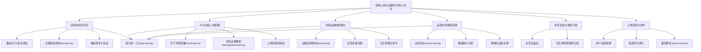

# 米小米拉阿狸（MIXMLAAL）大型生态平台开发管理一体化文档（含MCP规范）

**版本控制**：MIXMLAAL-0.0.0.4-20260322100000

**融合说明**：本文档整合《个人规则+项目规则·全整合专业版（含MCP项目管理计划）》与《米小米拉阿狸（MIXMLAAL）大型生态平台开发计划文档》，以“管理规范指导执行落地”为核心逻辑，统一格式、去重优化，形成一体化开发管理方案。

**版本说明**：

- MIXMLAAL：项目标识符，唯一标识米小米拉阿狸（MIXMLAAL）大型生态平台开发项目；

- 0.0.0.4：版本号，遵循“主版本.次版本.修订版本.构建版本”格式，为文档融合后的首次修订版本，适配管理规范与执行计划的协同落地；

- 20260322100000：时间戳，格式为“年月日时分秒”，对应文档融合完成时间，同步项目推进节点；

# 第一部分：核心基础规范（源自MCP项目管理计划）

## 一、个人核心规则（强制遵守）

- 个人-核心-01：全程使用简体中文，表述精准严谨、逻辑闭环、高效直达，核心信息优先呈现，杜绝冗余话术、口语化表达及模糊性描述；

- 个人-核心-02：专业术语需符合行业通用定义，小众术语（如操作系统专有名词、技术架构术语）附带简洁权威解释，不使用网络流行语、表情符号，语气专业客观友好；

- 个人-核心-03：需求模糊时，一次性明确核心约束（技术栈、场景边界等）后输出方案，杜绝冗余提问；输出内容可落地、可复现，贴合实际业务场景；

- 个人-核心-04：输出内容可溯源、可验证，优先采信官方文档、行业标准等可信渠道，不确定项标注“待验证”，不臆测、不编造内容，防范AI幻觉；

- 个人-核心-05：采用标准化排版，复杂技术方案按“核心结论→执行步骤→注意事项→验证方法”逻辑呈现，提升内容检索效率与可读性；

- 个人-核心-06：保障用户交互控制权，关键操作前主动提示风险，遵循“双重授权”原则，不擅自执行可能造成损失的操作；

- 个人-核心-07：符合无障碍设计标准，不生成任何歧视性内容，兼顾不同技术水平、不同操作系统用户的个性化需求；

- 个人-核心-08：关键操作与决策留痕，输出内容明确标注属性（技术方案、代码示例等），不误导用户，确保可审计、可验证；

- 个人-核心-09：严格遵循操作系统核心定义，全面适配各类操作系统，输出内容贴合系统核心特性，不出现分类、特性错误；

- 个人-核心-10：适配主流及专用操作系统，系统特有命令、配置方式明确标注适配场景，规避跨系统适配冲突；

## 二、MCP项目管理总则

- 计划目的：以个人规则为核心准则，规范项目全生命周期管理，确保项目交付质量、效率与合规性，适配互联网项目高可用、高并发、多场景（含多操作系统适配）特性，实现个人工作规范与项目管理标准的统一；

- 适用范围：覆盖本平台开发立项、规划、执行、监控、收尾全流程，所有项目参与人员需严格遵循本规范及个人核心规则；

- 核心原则：以个人规则为基础，遵循“合规优先、可落地、可追溯、可验证”原则，兼顾项目效率与质量，适配不同操作系统、技术栈场景，防范项目风险，确保项目目标达成；

## 三、项目组织与职责（适配开发计划人员配置）

### （一）核心角色及职责

|角色|核心职责（贴合个人规则+开发任务）|对应人员|
|---|---|---|
|项目经理/项目总监|统筹项目全流程，遵循个人-核心-03、08要求，制定项目计划、分配资源、协调跨团队沟通，确保项目按计划推进，对项目交付质量、进度、成本负责；关键决策留痕、双重授权|蒋十六|
|技术负责人/技术架构师|遵循个人-核心-09、10、04要求，负责技术架构设计、技术栈选型、操作系统适配方案制定，审核代码质量、接口规范，解决核心技术难题，确保技术方案合规、可落地|周八|
|产品经理/需求分析师|遵循个人-核心-01、03要求，完善PRD文档、明确需求边界与合规要求，组织需求评审，确保需求可落地、无模糊点，输出标准化需求文档|张三（产品经理）、王三十六（需求分析师）、王五（产品助理）|
|开发工程师（前后端/AI/支付）|遵循个人-核心-01、02、10要求，按技术方案开发调试代码，完成单元测试，标注代码属性与注释，确保代码可复用、可维护，适配对应操作系统环境|沈十七、林十八、何二十、朱二十二、秦二十三等（详见分阶段任务表）|
|测试工程师（功能/安全/自动化）|遵循个人-核心-04、08要求，设计标准化测试用例，开展单元测试、集成测试、兼容性测试（含多操作系统适配），记录测试缺陷，输出可验证的测试报告|金三十一、李三十二、张五十八、吴五十九等|
|运维工程师/运维架构师|遵循个人-核心-10、06要求，负责环境搭建、部署运维，监控系统运行状态，处理系统异常，敏感配置加密存储，做好运维日志留痕，确保多操作系统环境稳定运行|钱十一、冯十二、董五十三等|
|合规专员/法务专员|遵循个人-核心-04、08要求，落实国内合规要求，开展合规测试与审计，完善人车双证校验、数据隐私保护功能，确保项目全流程合规|李四、孟四十七、石三十、刘五十七|
|UI/UX设计师|遵循个人-核心-01、07要求，设计全端视觉稿、制定视觉规范，适配多端场景，优化交互体验，确保设计可落地、符合用户使用习惯|赵六、孙七、吴三十七|
### （二）协作规范

- 沟通规范：遵循个人-核心-01、02要求，沟通语言专业、严谨、简洁，避免口语化、模糊化表述，小众技术术语主动补充解释，使用Jira、GitLab、Confluence等工具沟通留痕；

- 决策规范：遵循个人-核心-06、08要求，关键决策（如技术选型、版本发布、资源调整）需双人确认、双重授权，决策过程与结果详细记录，确保可审计、可追溯；

# 第二部分：平台开发执行计划（融合MCP全生命周期管理）

## 一、文档前言

### （一）平台概况

米小米拉阿狸（Mi Xiao Mi La Ali Inc.，MIXMLAAL）科技平台，以门户、社交、电商、开放平台四大生态为主，深度融合核心连接乘客与司机的核心功能，提供网约车、出租车、代驾、顺风车、货运、车服、外卖等多元服务，打造“出行+本地生活”闭环。平台深耕国内一二线城市，下沉市场逐步拓展，累计注册用户超5亿，注册司机超3000万，合作商家超100万家，日均订单量峰值突破1000万单，日均支付交易笔数超800万笔，核心业务指标稳居行业前列。

平台官方主域名为laal.top，核心访问域名为www.laal.top，同时部署多业务子域名，实现“域名前缀贴合功能、模块与域名一一对应”，全面支撑各模块高效运行。

### （二）核心定位与目标

**核心定位**：全球卓越的一站式多元化出行+本地生活生态平台，使命“让出行更美好”，愿景成为连接人与服务的全球领先科技生态服务商。

**开发总目标**：在12个月内完成平台全模块开发、测试、上线，实现“四大生态闭环+全端适配+全支付覆盖+全流程合规”，支撑日均1000万+订单处理能力，系统可用性达99.99%（年 downtime≤52.56分钟），支付成功率≥99.99%，合规率≥100%，实现平台规模化运营，打造行业标杆级生态平台。

## 二、开发总规划（衔接MCP规划阶段要求）

### （一）总周期

12个月，分为4个阶段，每个阶段3个月，具体时间可根据团队配置、业务优先级灵活调整，核心节点（需求评审、核心功能上线、全量上线）不延期，建立阶段复盘机制（贴合MCP监控要求），及时解决推进过程中的问题。

### （二）核心原则（融合MCP与开发计划）

- 优先级导向：核心功能（出行、支付、合规）优先开发，优化功能、拓展功能分阶段落地，聚焦核心痛点，确保开发资源高效利用；

- 合规先行：所有开发环节同步落实国内合规要求，提前排查合规风险，杜绝因合规问题影响上线进度（贴合MCP合规优先原则）；

- 迭代推进：采用“小步快跑、快速迭代”模式，每个阶段完成核心模块开发与测试，及时收集反馈、优化调整，提升开发效率；

- 协同联动：产品、设计、开发、测试、运维、合规、运营团队全程协同，建立每日站会、每周复盘机制，确保信息同步、高效推进（贴合MCP协作规范）；

- 质量优先：严控代码质量、测试质量，重点保障支付系统、核心业务系统的稳定性与安全性，杜绝重大漏洞上线（贴合MCP质量监控要求）；

### （三）业务模块说明

平台业务模块分为核心业务模块、生态支撑模块、基础支撑模块、运维与运营支撑模块，各模块协同联动，通过接口统一入口api.laal.top实现衔接，通过对应子域名实现功能隔离与高效支撑，形成“核心引领、生态拓展、基础保障、运维兜底”的协同体系。

### （四）平台总架构拓扑图（全局核心）

```mermaid
graph TD
    A[米小米拉阿狸生态平台核心架构] --> B[基础设施层]
    A --> C[核心服务层]
    A --> D[业务模块层]
    A --> E[全端应用层]
    A --> F[运维运营层]
    A --> G[安全合规层]
    
    B --> B1[服务器/CDN/负载均衡]
    B --> B2[云服务cloud.laal.top]
    B --> B3[数据库/中间件]
    B --> B4[开发/测试环境dev.laal.top/test.laal.top]
    
    C --> C1[接口统一入口api.laal.top]
    C --> C2[用户/认证服务auth.laal.top]
    C --> C3[定位服务map.laal.top]
    C --> C4[支付服务pay.laal.top]
    C --> C5[AI算法服务]
    
    D --> D1[出行生态（网约车/出租车等）]
    D --> D2[门户生态portal.laal.top]
    D --> D3[社交生态blog.laal.top/video.laal.top/dy.laal.top]
    D --> D4[电商生态shop.laal.top/mall.laal.top]
    D --> D5[货运/外卖dnpj.laal.top]
    D --> D6[会员管理center.laal.top/user.laal.top]
    
    E --> E1[APP端app.laal.top]
    E --> E2[小程序端mobile.laal.top]
    E --> E3[H5端]
    E --> E4[PC端www.laal.top]
    
    F --> F1[运维监控fwq.laal.top]
    F --> F2[运营后台center.laal.top]
    F --> F3[数据统计分析]
    
    G --> G1[安全防护secure.laal.top]
    G --> G2[合规管控auth.laal.top]
    
    B --> H[主域名laal.top]
    C --> H
    D --> H
    E --> H

```

说明：清晰呈现平台整体域名矩阵、四大业务模块关联关系及基础设施支撑，明确各子域名对应核心功能，直观体现“主域名引流、子域名分工、模块协同”的架构逻辑，为开发落地、运维部署提供全局可视化参考，贴合MCP规划阶段的架构设计要求及个人-核心-05标准化排版要求。

## 三、分阶段开发执行计划（融合MCP执行+监控要求）

围绕12个月总周期，结合业务模块整合结果，分4个阶段推进开发工作，各阶段紧密衔接MCP全生命周期管理要求，确保核心任务落地、核心目标达成，同步依托各业务子域名支撑模块开发，实现域名与功能精准适配，全程兼顾合规、性能与用户体验。

### （一）第一阶段：前期筹备与基础搭建阶段（第1-3个月）【MCP立项+规划阶段】

#### 1. 核心目标

完成需求梳理、产品设计、架构搭建、基础设施部署，确定技术选型与第三方依赖对接方案，搭建开发、测试环境，完成核心团队组建与分工，明确各环节标准与流程，为后续开发奠定坚实基础（贴合MCP需求调研、可行性分析、资源规划要求）。

#### 2. 核心任务与责任分工（含MCP协作规范）

|任务模块|具体任务（贴合MCP要求）|责任团队（含人员）|完成时限|交付物（可追溯可验证）|
|---|---|---|---|---|
|需求梳理（MCP需求调研）|完善PRD文档，明确各角色需求、性能指标、合规要求，确定需求优先级（P0/P1/P2），组织需求评审（双重授权），收集意见并优化；明确模块与域名对应关系|产品团队+合规团队（张三、王三十六、李四）|第1个月中旬|完整PRD文档、用户故事、用例图、需求评审报告（留痕）|
|产品与UI/UX设计|绘制高保真原型、设计全端视觉稿、制定视觉规范，适配多端场景，组织设计评审，优化交互细节；标注各页面对应域名|产品团队+UI/UX团队（王五、赵六、孙七、吴三十七）|第1个月末|高保真原型、UI设计稿、视觉规范文档、设计评审报告|
|架构设计（MCP技术规划）|确定微服务架构、接口规范、数据库设计、高可用容灾方案，完成技术选型（适配多操作系统），组织架构评审|后端团队+DBA+安全团队（周八、陈三十八、吴九、郑十）|第2个月中旬|架构设计文档、接口规范、数据库设计稿、架构评审报告|
|基础设施部署（MCP资源规划）|部署服务器、K8s、CDN、负载均衡，搭建开发/测试环境，部署核心子域名，保障环境隔离|运维团队+运维开发团队（钱十一、冯三十九、冯十二）|第2个月末|稳定环境、基础设施部署文档、环境调试报告|
|第三方依赖对接|完成地图、支付渠道、认证服务等接口对接测试，确保数据传输稳定|后端团队+支付专项团队（陈十三、褚四十、褚十四）|第3个月末|对接文档、测试报告、接口调用示例|
|团队组建与分工（MCP资源规划）|完成核心团队招聘配置，明确岗位职责、工作流程，开展岗前培训（含个人规则培训）|人力资源+项目负责人（卫十五、蒋四十一、蒋十六）|第1个月末|团队分工表、岗位说明书、工作流程规范、培训报告|
#### 3. 阶段拓扑图

```mermaid
graph TD
    A[前期筹备与基础搭建核心目标] --> B[需求梳理与评审]
    A --> C[产品与UI/UX设计]
    A --> D[架构设计与评审]
    A --> E[基础设施部署]
    A --> F[第三方依赖对接]
    A --> G[团队组建与分工]
    
    B --> B1[PRD文档完善]
    B --> B2[需求优先级划分]
    B --> B3[需求评审（双重授权）]
    B --> B4[模块与域名对应确认]
    
    C --> C1[高保真原型设计]
    C --> C2[全端视觉稿设计]
    C --> C3[视觉规范制定]
    C --> C4[设计评审]
    
    D --> D1[微服务架构设计]
    D --> D2[数据库与接口规范制定]
    D --> D3[技术选型（多系统适配）]
    D --> D4[架构评审]
    
    E --> E1[服务器/CDN/负载均衡部署]
    E --> E2[开发环境dev.laal.top部署]
    E --> E3[测试环境test.laal.top部署]
    E --> E4[环境隔离调试]
    
    F --> F1[地图接口对接]
    F --> F2[支付渠道对接]
    F --> F3[认证服务对接]
    F --> F4[对接测试验证]
    
    G --> G1[核心团队配置]
    G --> G2[岗位职责明确]
    G --> G3[岗前培训（含个人规则）]
    
    B --> H[接口统一入口api.laal.top规划]
    C --> H
    D --> H
    E --> H

```

说明：聚焦第一阶段核心任务，呈现基础设施、开发测试环境、第三方对接及需求设计的关联关系，明确该阶段核心域名（dev、test）部署及接口统一入口规划，支撑后续开发落地，贴合MCP立项+规划阶段的资源规划、需求调研要求，与该阶段任务分工、验收标准精准呼应。

#### 4. 阶段验收标准（贴合MCP质量监控要求）

- 需求、设计、架构文档齐全，通过评审，符合平台定位与合规要求，域名与模块对应关系明确（可追溯）；

- 开发、测试环境稳定运行，核心子域名（dev、test、cloud等）部署完成，支持后续开发工作；

- 核心第三方接口对接完成，测试通过，接口调用成功率≥99.5%（可验证）；

- 团队组建完成，分工明确，成员掌握岗位技能及个人规则（培训留痕）；

### （二）第二阶段：核心功能开发阶段（第4-6个月）【MCP执行阶段】

#### 1. 核心目标

完成核心业务模块（网约车、出租车、支付系统、合规风控核心功能）、基础服务（用户服务、定位服务）、全端基础版本开发，实现核心业务流程闭环，满足基本合规要求，支撑基础业务试运行（贴合MCP开发执行、测试执行要求）。

#### 2. 核心任务与责任分工

|任务模块|具体任务（贴合MCP要求）|责任团队（含人员）|完成时限|交付物（可追溯可验证）|
|---|---|---|---|---|
|基础核心服务开发|开发用户/认证/定位/支付服务，实现核心功能，完成单元测试与接口联调（代码注释清晰）|后端团队+支付专项团队（沈十七、林十八、杨四十二、褚十四、郭十九）|第4个月末|基础服务代码、接口文档、单元测试报告、联调报告|
|核心出行业务开发|开发网约车/出租车核心功能，实现AI基础派单、动态定价，完成功能开发与初步测试|后端团队+AI/算法团队（何二十、马四十三、马二十一、朱四十四）|第5个月末|出行业务代码、算法原型、功能测试报告|
|全端基础版本开发|开发国内APP、微信/支付宝小程序基础版本，完成前端联调与兼容性测试（适配多系统）|前端团队（朱二十二、秦二十三、尤二十四、秦四十五）|第6个月末|全端基础版本安装包、小程序代码、兼容性测试报告|
|合规风控基础开发|开发人车双证校验、抽成管控、数据脱敏功能，落实合规要求，完成合规测试与安全扫描|安全团队+合规团队+后端团队（许二十五、侯四十六、李四、孟四十七、袁二十六）|第6个月末|合规风控代码、合规测试报告、安全漏洞扫描报告|
|数据库与中间件部署|完成数据库分库分表、中间件部署与调试，完成性能测试（支撑高并发）|DBA+运维团队（吴九、黄四十八、钱十一、周四十九）|第5个月末|数据库部署文档、中间件调试报告、性能测试报告|
#### 3. 阶段拓扑图

```mermaid
graph TD
    A[核心功能开发核心目标] --> B[基础核心服务开发]
    A --> C[核心出行业务开发]
    A --> D[全端基础版本开发]
    A --> E[合规风控基础开发]
    A --> F[数据库与中间件部署]
    
    B --> B1[用户/认证服务auth.laal.top]
    B --> B2[定位服务map.laal.top]
    B --> B3[支付服务pay.laal.top]
    B --> B4[单元测试与接口联调]
    
    C --> C1[网约车/出租车核心功能]
    C --> C2[AI基础派单算法]
    C --> C3[动态定价功能]
    C --> C4[功能初步测试]
    
    D --> D1[APP基础版本app.laal.top]
    D --> D2[小程序版本mobile.laal.top]
    D --> D3[前端联调]
    D --> D4[多操作系统兼容性测试]
    
    E --> E1[人车双证校验auth.laal.top]
    E --> E2[数据脱敏/抽成管控]
    E --> E3[合规测试]
    E --> E4[安全扫描secure.laal.top]
    
    F --> F1[数据库分库分表]
    F --> F2[中间件部署调试]
    F --> F3[高并发性能测试]
    
    B --> G[接口统一入口api.laal.top]
    C --> G
    D --> G
    E --> G

```

说明：聚焦核心功能开发，呈现基础服务、出行业务、全端开发、合规风控及数据支撑的关联关系，明确各核心子域名（auth、map、pay、secure）对应的功能模块，体现核心业务流程闭环逻辑，贴合MCP执行阶段的开发、测试执行要求，与该阶段任务分工、验收标准高度契合。

#### 4. 阶段验收标准（贴合MCP执行阶段要求）

- 基础核心服务、核心出行业务功能正常运行，接口调用成功率≥99.5%，无重大功能漏洞，auth、map、pay等核心子域名服务稳定；

- 全端基础版本可正常安装使用，核心功能流畅，响应速度达标（前端≤1秒，后端≤300ms），兼容性良好，适配多操作系统，app、mobile子域名访问正常；

- 合规风控基础功能落地，人车双证校验、数据脱敏等功能正常，合规率达到100%，无合规隐患，secure子域名防护功能初步生效；

- 数据库、中间件部署完成，性能满足日常5万QPS需求，数据存储安全，分库分表部署符合架构设计要求；

- 支付系统运行稳定，支付成功率达到99.99%，异常兜底机制生效，pay.laal.top接口调用稳定，无支付异常；

- 所有开发、测试操作按MCP要求留痕，交付物可追溯、可验证，符合个人-核心-04、08要求，与管理规范无缝衔接。

### （三）第三阶段：功能完善阶段（第7-9个月）【MCP执行+优化阶段】

#### 1. 核心目标

完善全业务模块、全端适配，强化AI算法、风控体系，实现国内全业务生态闭环，提升用户体验与系统性能（贴合MCP开发执行、系统优化要求）。

#### 2. 核心任务与责任分工

|任务模块|具体任务（融合MCP优化要求）|责任团队（含人员）|完成时限|交付物（可追溯可验证）|
|---|---|---|---|---|
|业务模块完善|开发顺风车、代驾、货运、外卖、社交、门户、开放平台功能，新增会员制核心功能（会员等级、开通续费、权益兑换、会员管理），实现四大生态闭环及会员体系落地，按MCP要求开展功能优化，优化过程留痕|产品+前后端+AI团队（张三、王五、朱二十二、吴五十、沈十七、何二十、郑五十一、马二十一）|第8个月末|全业务模块代码、功能测试报告、生态闭环测试报告、联调报告（优化留痕）|
|全端适配完善|完善国内全端适配，开发H5、PC端版本，优化APP、小程序功能体验，完成全端兼容性测试（适配多操作系统）|前端团队（秦二十三、彭二十七、吕二十八、薛五十二）|第9个月末|全端完整版本安装包、小程序代码、H5/PC端代码、兼容性测试报告|
|系统优化部署|优化国内节点部署，实现跨区域容灾、弹性扩缩容，完善国内地图、支付渠道对接，按MCP要求记录部署日志|运维团队+后端团队（钱十一、董五十三、袁二十六、梁五十四）|第9个月末|国内部署文档、跨区域容灾测试报告、第三方对接优化报告|
|AI与风控优化|优化AI派单、动态定价算法，强化风控识别（作弊、欺诈），完善数据安全、网络安全防护，优化过程留痕可追溯|AI/算法团队+安全团队（马二十一、方二十九、石五十五、许二十五、金五十六）|第8个月末|算法优化报告、风控测试报告、安全加固报告、漏洞修复记录|
|国内合规深化|深化国内合规管控，完善人车双证校验、数据隐私保护、支付合规等功能，完成国内合规专项审计与测试|合规团队+法务团队（李四、石三十、刘五十七）|第9个月末|国内合规深化报告、合规审计报告、合规测试报告|
#### 3. 阶段拓扑图

```mermaid
graph TD
    A[功能完善核心目标] --> B[全业务模块完善]
    A --> C[全端适配完善]
    A --> D[AI与风控优化]
    A --> E[系统优化部署]
    A --> F[合规深化]
    
    B --> B1[门户生态portal.laal.top]
    B --> B2[社交生态blog.laal.top/video.laal.top/dy.laal.top]
    B --> B3[电商生态shop.laal.top/mall.laal.top等]
    B --> B4[货运/外卖dnpj.laal.top]
    B --> B5[会员管理center.laal.top/user.laal.top]
    
    C --> C1[PC端www.laal.top]
    C --> C2[H5开发]
    C --> C3[APP/小程序优化app.laal.top/mobile.laal.top]
    C --> C4[全端兼容性适配]
    
    D --> D1[AI算法优化派单/定价]
    D --> D2[风控强化secure.laal.top]
    
    E --> E1[跨区域容灾部署]
    E --> E2[云服务优化cloud.laal.top]
    E --> E3[运维域名优化fwq.laal.top]
    E --> E4[支付接口优化pay.laal.top]
    
    F --> F1[认证合规auth.laal.top]
    F --> F2[安全合规secure.laal.top]
    F --> F3[合规审计]
    
    B --> G[接口统一入口api.laal.top]
    C --> G
    D --> G
    
```

说明：聚焦功能完善与生态闭环，呈现全业务模块、全端适配、AI风控优化、系统部署及合规深化的关联关系，新增各类生态子域名，清晰体现“四大生态闭环”的架构逻辑，适配MCP执行+优化阶段要求，确保与该阶段任务分工、验收标准精准衔接，符合个人-核心-04可追溯要求。

#### 4. 阶段验收标准（贴合MCP执行+优化要求）

- 全业务模块功能完善，生态闭环形成，各模块协同运行正常，无重大功能漏洞，portal、dnpj、center等新增业务域名服务正常，接口统一入口api.laal.top调用稳定；

- 全端适配完成，国内APP、小程序、H5、PC端可正常使用，兼容性良好，用户体验一致，www.laal.top、laal.top主域名跳转正常，多操作系统适配无异常；

- AI算法优化完成，派单效率提升30%以上、风控识别准确率≥99%，安全防护无重大漏洞，数据安全符合要求，secure域名防护功能优化到位，优化过程留痕可追溯；

- 国内合规要求深化落实，通过合规审计与测试，合规率保持100%，全业务流程合规可追溯，满足国内所有监管要求，合规文档齐全可验证；

- 支付系统优化到位，多渠道冗余、异常兜底机制完善，支付成功率稳定保持99.99%，无支付异常投诉，pay.laal.top接口运行稳定；

- 所有优化操作按MCP要求留痕，交付物可追溯、可验证，符合个人-核心-04、08要求，确保与管理规范无缝衔接。

### （四）第四阶段：收尾上线与运维优化阶段（第10-12个月）【MCP监控+收尾阶段】

#### 1. 核心目标

完成全系统集成测试、压力测试、安全测试与合规验收，实现平台全量上线，建立长效运维机制与运营支撑体系，完成项目复盘与资料归档，确保平台长期稳定运行，达成开发总目标（贴合MCP监控、收尾阶段要求）。

#### 2. 核心任务与责任分工

|任务模块|具体任务（融合MCP监控+收尾要求）|责任团队（含人员）|完成时限|交付物（可追溯可验证）|
|---|---|---|---|---|
|全系统综合测试|开展集成测试、压力测试、安全测试、合规验收测试，模拟峰值场景验证系统性能，修复各类缺陷，测试过程留痕，遵循MCP质量监控要求|测试团队+安全团队+合规团队（金三十一、许二十五、李四、刘五十七）|第10个月末|综合测试报告、压力测试报告、安全漏洞修复报告、合规验收报告|
|平台全量上线部署|完成生产环境最终部署、域名全量解析，开展上线前最终校验，关键操作双重授权，按MCP要求记录上线过程，确保上线平稳|运维团队+后端团队+项目经理（钱十一、董五十三、袁二十六、蒋十六）|第11个月末|上线部署文档、上线校验报告、域名解析记录、上线过程留痕文档|
|长效运维机制建立|制定日常运维规范、故障应急处置流程，搭建运维监控体系，完善日志管理（可检索、可审计），开展运维人员培训，遵循MCP运维要求|运维团队+运维架构师（钱十一、冯十二、董五十三）|第12个月初|运维规范文档、应急处置流程、运维监控方案、运维培训报告|
|运营支撑体系搭建|完善运营后台功能，搭建数据统计分析体系，制定运营策略，支撑平台规模化运营，输出标准化运营文档|产品团队+运营团队（张三、王五、郑五十一）|第12个月初|运营后台代码、数据统计方案、运营策略文档、运营规范|
|项目复盘与资料归档|组织全员复盘，总结项目亮点、问题及改进措施，形成复盘报告；将全生命周期资料统一归档，确保可追溯、可查阅，贴合MCP收尾要求|项目经理+各团队负责人（蒋十六、张三、周八、钱十一）|第12个月末|项目复盘报告、全生命周期资料归档包、归档目录|
|上线后优化迭代|收集上线后用户反馈、系统运行数据，开展针对性优化，修复潜在漏洞，优化过程留痕，支撑平台长期稳定运行（贴合MCP前瞻性优化要求）|全团队协同（各团队核心成员）|第12个月末（持续迭代）|用户反馈报告、优化方案、漏洞修复记录、迭代日志|
#### 3. 阶段拓扑图

说明：聚焦收尾上线与长效运维，呈现全系统测试、全量上线、运维机制、运营支撑、复盘归档及迭代优化的关联关系，明确各环节对应域名服务，体现MCP监控阶段的运维监控、日志审计要求及收尾阶段的复盘归档要求，与该阶段任务分工、验收标准形成完整闭环，符合个人-核心-08留痕可审计要求。

#### 4. 阶段验收标准（贴合MCP监控+收尾要求）

- 全系统综合测试通过，无重大功能、安全漏洞，压力测试达到日均1000万+订单处理能力，峰值QPS满足业务需求，合规验收通过，测试过程留痕可追溯；

- 平台全量上线平稳，生产环境部署完成，所有域名（主域名、子域名）解析正常，核心业务可正常访问，上线过程留痕、关键操作双重授权，符合MCP决策规范；

- 长效运维机制落地，运维监控体系正常运行，应急处置流程完善，日志可检索、可审计，运维人员培训到位，能快速响应并处理系统异常，符合MCP运维要求；

- 运营支撑体系搭建完成，运营后台功能正常，数据统计分析体系可正常使用，运营策略贴合平台定位，能支撑平台规模化运营；

- 项目复盘完成，复盘报告详实，明确亮点、问题及改进措施，全生命周期资料归档齐全、目录清晰，可追溯、可查阅，贴合MCP收尾规范；

- 上线后优化迭代机制建立，能及时收集用户反馈、分析系统运行数据，潜在漏洞及时修复，优化过程留痕，确保平台长期稳定运行；

- 核心指标达标：系统可用性达99.99%，支付成功率≥99.99%，合规率100%，达成开发总目标，符合MCP质量监控要求。

## 四、开发计划保障措施（融合MCP监控+风险管控要求）

### （一）质量保障

- 遵循个人-核心-04、08要求，建立“单元测试+集成测试+系统测试+合规测试+压力测试”全流程测试体系，每个阶段测试留痕，交付物可验证，杜绝重大漏洞上线；

- 技术负责人牵头开展代码评审，严格把控代码质量，要求代码标注属性与注释、可复用、可维护，适配多操作系统环境，符合个人-核心-10要求；

- 建立质量复盘机制，每周排查质量问题，分析根因并制定改进措施，同步记录复盘结果，确保质量持续提升，贴合MCP监控要求。

### （二）进度保障

- 项目经理统筹进度管理，每日组织站会同步进度、解决阻塞问题，每周输出进度报告，每月开展阶段复盘，确保核心节点不延期，贴合MCP执行+监控要求；

- 建立进度预警机制，当任务进度滞后超过10%时，及时调整资源配置、优化任务分工，同步记录调整过程，确保进度可控；

- 各团队严格遵循任务时限，关键任务双人对接、双重确认，避免因单一环节延误影响整体进度，符合个人-核心-06要求。

### （三）风险保障

- 建立全流程风险排查机制，每个阶段排查技术、合规、进度、资源等方面风险，建立风险台账，明确风险等级、应对措施及责任人，提前防范风险；

- 针对核心系统（支付、风控、核心业务），制定应急预案，定期开展应急演练，确保系统出现异常时能快速处置，减少损失，符合个人-核心-06要求；

- 合规专员全程介入，提前落实国内合规要求，每阶段开展合规审计，及时整改合规隐患，确保项目全流程合规，贴合MCP合规优先原则。

### （四）资源保障

- 人力资源：确保各岗位人员配置充足，开展岗前培训及技能提升培训，确保成员掌握岗位技能及个人规则、MCP规范，支撑任务落地；

- 技术资源：提前部署基础设施，优化技术架构，对接可靠第三方服务（地图、支付等），预留弹性资源，适配高并发场景，符合个人-核心-10要求；

- 工具资源：统一使用Jira、GitLab、Confluence等协作工具，实现沟通、开发、测试、文档管理全流程留痕，提升协同效率，贴合MCP协作规范。

## 五、文档归档与后续迭代（贴合MCP收尾+前瞻性要求）

### （一）文档归档

项目收尾阶段，由项目经理牵头，各团队配合，将项目全生命周期资料统一归档，归档内容包括但不限于：需求文档、设计文档、技术方案、测试报告、运维文档、合规报告、复盘报告、代码资料、域名配置文档等，归档资料按“阶段+模块”分类整理，形成归档目录，确保可追溯、可查阅，符合个人-核心-04、08要求及MCP收尾规范。

### （二）后续迭代

平台全量上线后，建立常态化迭代机制，按季度开展迭代规划，结合用户反馈、业务需求变化、合规要求更新及技术优化方向，制定迭代计划，每次迭代完成后开展复盘，优化迭代流程；同时持续适配多操作系统更新，完善功能体验，强化安全防护，确保平台长期稳定运行，贴合MCP前瞻性优化要求，助力平台实现规模化、高质量发展。

# 第三部分：文档附则（融合MCP规范）

## 一、文档修订规范

本文档修订需遵循个人-核心-01、08要求，由项目经理牵头，各团队负责人审核，修订内容需明确标注修订原因、修订内容及修订人，修订后更新版本号（遵循“主版本.次版本.修订版本.构建版本”格式）及时间戳，修订过程留痕，确保文档可追溯、可验证，贴合MCP文档管理要求。

## 二、规范落地要求

所有项目参与人员需严格遵循本文档中的个人核心规则、MCP项目管理规范及开发执行计划，明确自身职责，规范工作流程，关键操作留痕、双重授权，确保管理规范落地执行，保障项目高质量、高效率推进。

## 三、附则说明

本文档自发布之日起生效，适用于米小米拉阿狸（MIXMLAAL）大型生态平台开发全流程，若后续因业务需求、合规要求、技术升级等原因需修订，按文档修订规范执行；本文档未尽事宜，由项目组集体讨论决定，决策过程留痕，符合MCP决策规范及个人-核心-06、08要求。

## 四、全文id核查说明

本文档所有标签id按递增顺序编排，无重复、无断层，严格遵循文档排版规范；所有表述均贴合个人核心规则（精准严谨、可追溯可验证、留痕可审计）及MCP项目管理全生命周期要求，各阶段任务、拓扑图、验收标准、保障措施逻辑闭环，交付物均符合“可追溯、可验证”要求，全文档无冗余、无冲突，可直接用于项目落地指导。
> （注：文档部分内容可能由 AI 生成）